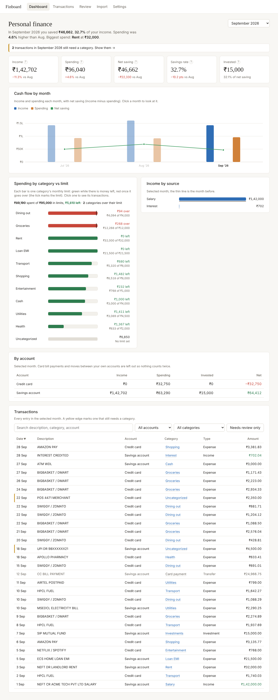
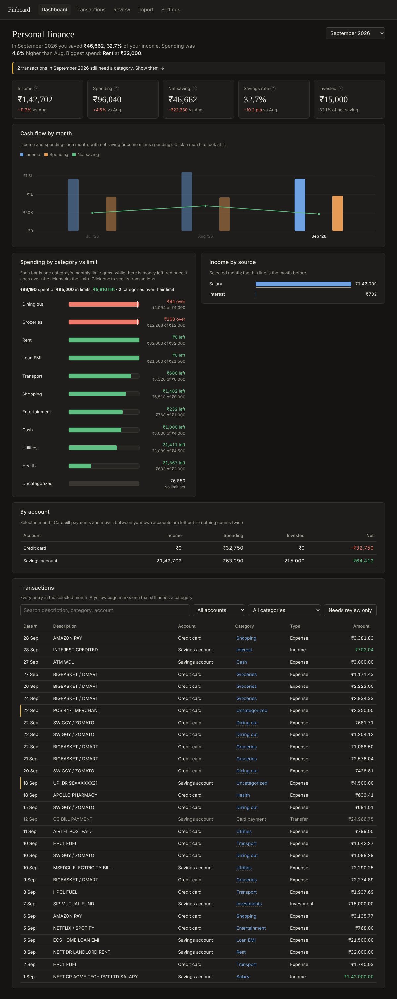

# Finboard

A private personal-finance app. Import your bank statements (password-protected PDFs), let
**rules you control** categorise every transaction, and see where your money goes:
income, spending, savings rate, monthly limits and per-account totals.

Your data stays on your machine. The code is open source (MIT); your statements never are.

| Light | Dark |
|---|---|
|  |  |

*Screenshots show the synthetic demo data (`finboard demo-data`), not anyone's real finances.*

> **Status:** feature-complete for v1 and packaged for Docker; the first tagged release is
> pending. Bank-specific parsers so far: **ICICI Bank savings**. Other statements go through
> the generic table parser, and [adding your bank](CONTRIBUTING.md#how-to-add-your-bank) needs
> no change to the core. See [docs/ROADMAP.md](docs/ROADMAP.md).

## Install

You need [Docker](https://docs.docker.com/get-started/get-docker/) (Docker Desktop on Windows
and macOS) and this repository's `deploy/` folder.

```sh
git clone https://github.com/kapilsharma/finboard.git
cd finboard
docker compose -f deploy/compose.yaml run --rm init   # once: writes deploy/.env
docker compose -f deploy/compose.yaml up -d
```

Open **http://127.0.0.1:8765**.

- `init` writes `deploy/.env` with a generated secret key and database passwords. Keep the file
  private and keep a copy with your backups; running `init` again never changes it.
- Only the app is published, and only on `127.0.0.1`. The database, Redis and the background
  worker sit on an internal Docker network that the host network and the internet can't reach.
- Your data lives in two Docker volumes, `finboard_db-data` (database) and `finboard_data`
  (the statements you imported, still bank-encrypted, and backups). They survive
  `docker compose down` and upgrades. **`down -v` deletes them.**
- To look around first, load synthetic sample data into the empty app:
  `docker compose -f deploy/compose.yaml exec api finboard demo-data`.
  Settings › Data › Delete all removes it again.

Finboard has no login: anyone who can use your computer's browser can open it. Use OS disk
encryption (BitLocker, FileVault, LUKS) to protect the data at rest.

### Upgrade

```sh
git pull
docker compose -f deploy/compose.yaml pull
docker compose -f deploy/compose.yaml up -d
```

When the new version changes the database, Finboard first writes a `pg_dump` of the old one
to `/data/backups` in the `finboard_data` volume, then migrates. If that backup fails, it
doesn't migrate.

### Back up and move

Settings › Data › Export gives one zip with everything (and Import restores it into an empty
Finboard). That file holds your finances in plain form: store it somewhere encrypted.

### Settings in `deploy/.env`

| Variable | Default | Meaning |
|---|---|---|
| `FINBOARD_PORT` | `8765` | Port on `127.0.0.1` |
| `FINBOARD_IMAGE` | `ghcr.io/kapilsharma/finboard:latest` | Image to run; pin a version like `:1.0.0` if you prefer |
| `FINBOARD_API_WORKERS` | `2` | API processes |
| `FINBOARD_WORKER_CONCURRENCY` | `2` | Statements parsed at the same time |

## AI features (optional, off by default)

Nothing AI-related runs unless you turn it on here **and** each user opts in under
Settings › AI. Both features need the `-ai` image.

```sh
# deploy/.env
FINBOARD_IMAGE=ghcr.io/kapilsharma/finboard:latest-ai
FINBOARD_AI_SUGGESTIONS=true          # category suggestions, computed on your machine
FINBOARD_AI_ASK=gemini                # Ask Finboard: questions answered as charts
FINBOARD_GEMINI_API_KEY=...           # from Google AI Studio
```

- **Category suggestions** use an embedding model that ships inside the `-ai` image and
  pgvector in the same database. Nothing leaves the machine.
- **Ask Finboard** answers questions like *"monthly breakdown of eating out and provisions in
  the last six months"* as a chart you can pin to the dashboard. It sends only your question,
  the query schema, your category names and anonymised account labels to the LLM you
  configure. Transactions, descriptions, amounts and results never leave the machine
  ([ADR-0030](docs/adr/0030-assistive-ai-opt-in.md)). On Gemini's free tier, Google may use the
  text it receives to improve its products. `FINBOARD_AI_ASK=ollama` uses a local model instead.

How well they work: [docs/ai-eval.md](docs/ai-eval.md). Design:
[ARCHITECTURE §18](docs/ARCHITECTURE.md#18-ai-features-optional).

## Privacy

- No telemetry, no update checks, no CDNs or web fonts: every asset is in the image. The one
  outbound path is Ask Finboard, if you turn it on.
- Statement passwords are never stored. You type one at each import; it is encrypted, held
  for at most two minutes on its way to the worker, and then gone.
- Logs hold ids, counts and timings, never descriptions, amounts, file names or passwords.

## Architecture in one picture

React SPA → FastAPI (async, stateless) → PostgreSQL (row-level security per user), with slow work
(PDF parsing) on Celery workers via Redis. Built for one user on one machine today, structured for
many users later. Details: [docs/ARCHITECTURE.md](docs/ARCHITECTURE.md), the decision records in
[docs/adr/](docs/adr/README.md), and what each milestone built in
[docs/BUILD_NOTES.md](docs/BUILD_NOTES.md).

## Development

Prerequisites: Docker, [uv](https://docs.astral.sh/uv/), Node 22+.

```sh
docker compose -f deploy/compose.dev.yaml up -d   # Postgres 18 + Redis 7 on 127.0.0.1 only
cd frontend && npm install && cd ..
cd backend && uv sync
uv run finboard dev                               # API (reload) + worker + Vite
```

Open http://127.0.0.1:5173. API docs: http://127.0.0.1:8765/api/docs (development only).

No Docker (e.g. a cloud sandbox on Debian/Ubuntu)? `bash scripts/setup-native-services.sh` installs
and starts the same Postgres and Redis natively.

**Before pushing:** `bash scripts/ci-local.sh` runs the same checks as GitHub Actions
(`--fast` for a quicker loop; `scripts\ci-local.ps1` on Windows). Contributors and AI coding
sessions: see [CLAUDE.md](CLAUDE.md) for conventions and the definition of done.

| Task | Command (from `backend/` or `frontend/`) |
|---|---|
| Backend tests (needs the dev services) | `uv run pytest` |
| Backend lint / types / layers | `uv run ruff check src tests` · `uv run mypy` · `uv run lint-imports` |
| Frontend tests / lint / types | `npm test` · `npm run lint` · `npm run typecheck` |
| Regenerate API types after changing the API | `npm run gen:api` |
| New migration | `uv run alembic revision --autogenerate -m "…"` (then add RLS for new user tables) |
| Single-port mode without Docker | `npm run build` then `uv run finboard serve` → http://127.0.0.1:8765 |
| Run the packaged stack from this checkout | `docker compose -f deploy/compose.yaml -f deploy/compose.build.yaml up -d --build` |
| Smoke-test the packaged stack | `bash scripts/smoke-compose.sh --e2e` (its own project, port and volumes) |

### Privacy rules for contributors

- Never commit statements, databases, dumps or exports. A pre-commit hook and CI enforce this
  (`scripts/check_no_private_data.py`). Install hooks with `uvx pre-commit install`.
- Test fixtures are generated synthetic PDFs. Never attach a real statement to an issue.

## Licence

[MIT](LICENSE)
