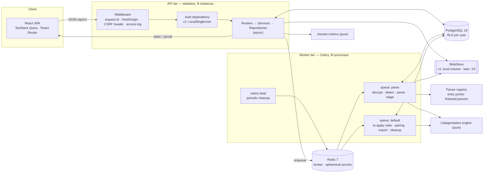
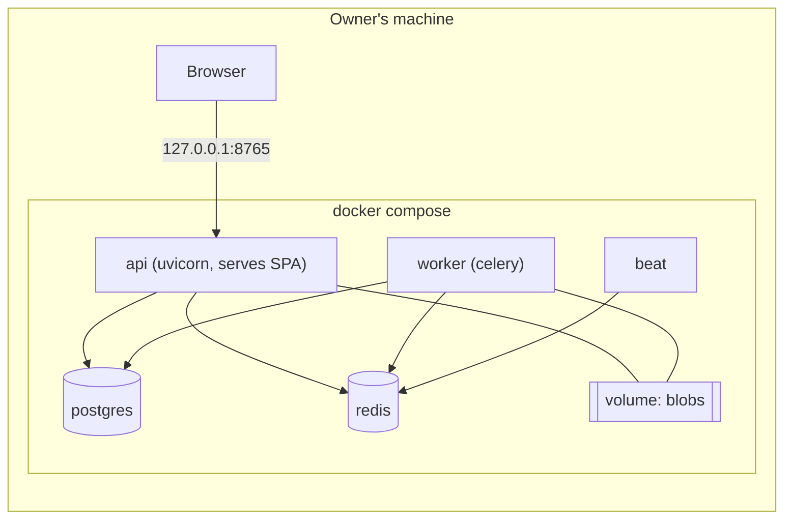
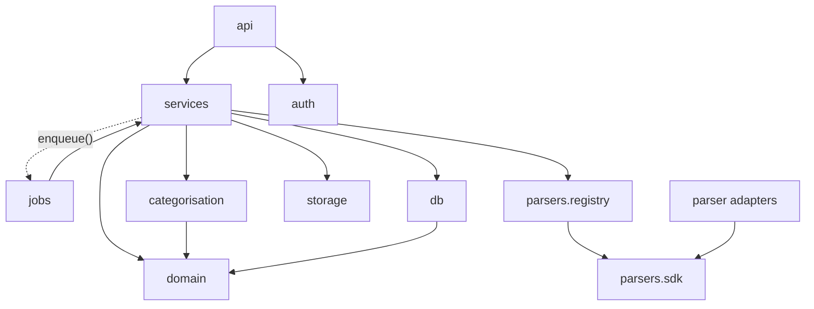
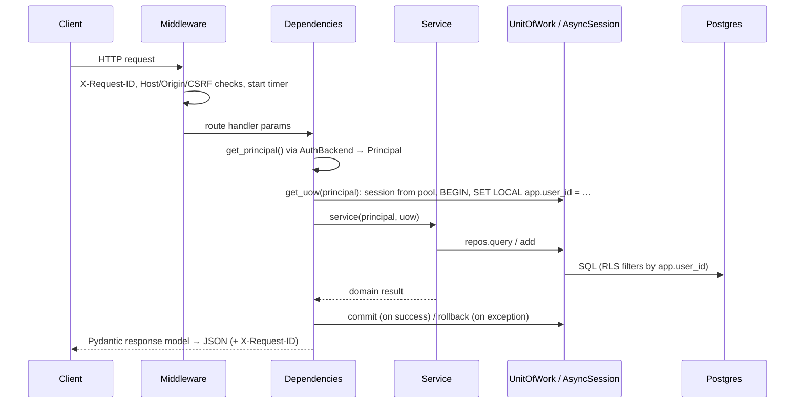
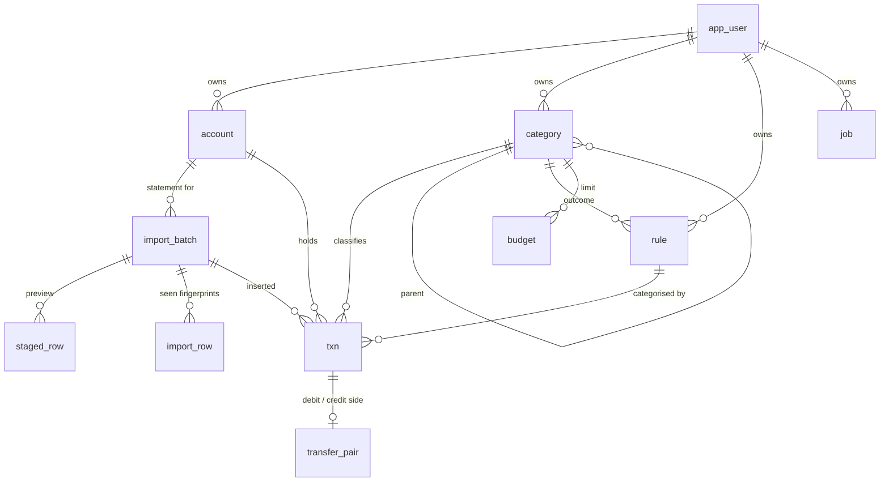
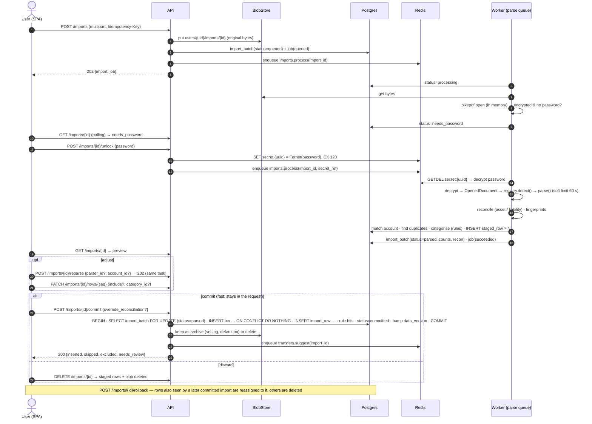
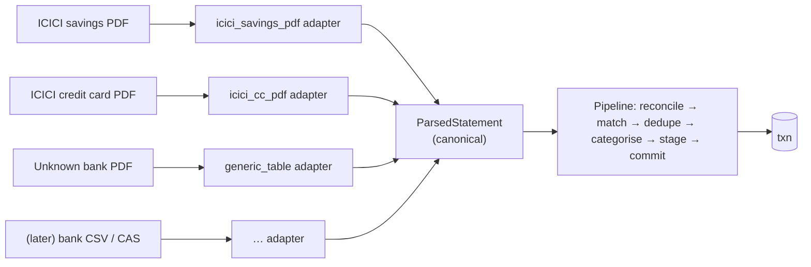
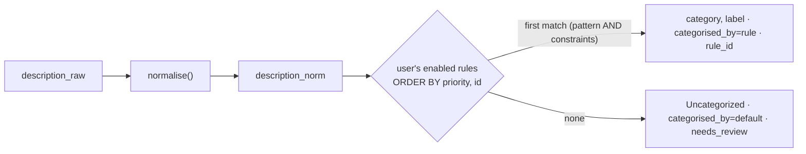
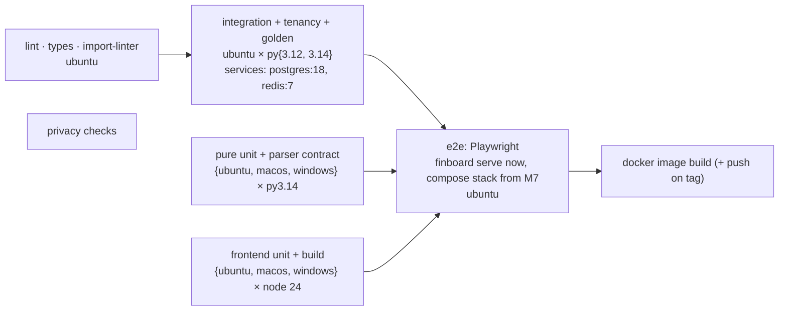
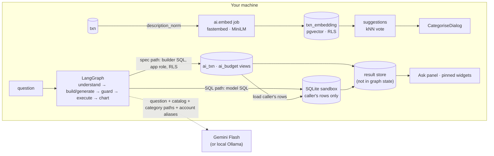

# Finboard — Architecture

> Status: **draft for review**, revision 3 (2026-11-04). Revision 2 made the backend async, ready for multiple users, on PostgreSQL with Celery/Redis jobs. Revision 3 adds optional AI features (§18).
> Inputs: [`handover/HANDOVER.md`](handover/HANDOVER.md), [`handover/design/`](handover/design/). Decisions: [`adr/`](adr/README.md).
> Plan: [`ROADMAP.md`](ROADMAP.md). Unresolved: [`OPEN_QUESTIONS.md`](OPEN_QUESTIONS.md).

**Design stance ([ADR-0021](adr/0021-multi-user-ready-single-user-first.md)):** v1 is still run by one person on their own machine. The *architecture* assumes hundreds of users from day one: async I/O, stateless API instances, every row owned by a user, isolation enforced in the database, slow work on a job queue, and auth behind one dependency. Going from "my laptop" to "hosted for many" should mean swapping implementations, not redesigning.

Contents: [1 Overview](#1-system-overview) · [2 Repo layout](#2-repo-layout) · [3 Backend modules](#3-backend-modules) · [4 FastAPI at scale](#4-fastapi-at-scale-request-lifecycle--patterns) · [5 Data model](#5-data-model) · [6 Background jobs](#6-background-jobs) · [7 Import pipeline](#7-import-pipeline) · [8 Parser adapters](#8-parser-adapters-plugin-system) · [9 Categorisation](#9-categorisation-engine) · [10 REST API](#10-rest-api) · [11 Frontend](#11-frontend-architecture) · [12 Metrics](#12-metric-definitions-single-spec) · [13 Security](#13-security--privacy) · [14 Scaling](#14-scaling--capacity) · [15 Testing & CI](#15-testing-strategy--ci) · [16 Run experience](#16-developer--user-run-experience) · [17 Extension points](#17-extension-points) · [18 AI features](#18-ai-features-optional)

---

## 1. System overview



**v1 deployment** is Docker Compose on the owner's machine, with the API published on `127.0.0.1:8765` only:



**Future hosted deployment** keeps the same images: TLS reverse proxy → `api × N` → managed Postgres + Redis + S3-compatible store, with `worker × M`. Only configuration changes (`FINBOARD_MODE=server`, auth backend, blob backend).

---

## 2. Repo layout

```
finboard/
├── backend/
│   ├── pyproject.toml              # uv project; `finboard` CLI; built-in parser entry points
│   ├── alembic.ini
│   ├── src/finboard/
│   │   ├── main.py                 # create_app(): routers, middleware, lifespan, static mount
│   │   ├── cli.py                  # finboard [serve|worker|beat|dev|migrate|create-user|parsers]
│   │   ├── core/                   # config.py (pydantic-settings), logging.py (structlog + redaction)
│   │   ├── auth/                   # Principal, AuthBackend protocol, LocalSingleUserBackend, (M8) sessions
│   │   ├── api/
│   │   │   ├── deps.py             # get_principal, get_uow, pagination, idempotency
│   │   │   ├── middleware.py       # request id, host/origin/CSRF guard, timing (pure ASGI)
│   │   │   ├── errors.py           # domain errors → RFC 9457 problem+json
│   │   │   ├── schemas.py          # Pydantic request/response models (split per area as it grows)
│   │   │   └── routers/            # accounts, categories, rules, imports, transactions, review,
│   │   │                           # transfers, budgets, dashboard, parsers, jobs, data, me, health
│   │   ├── services/               # use cases (async), one per area; own the transaction boundary
│   │   ├── domain/                 # enums, errors; later money, metrics, fingerprint, reconcile (pure)
│   │   ├── categorisation/         # normalise, matcher, suggest, pairing                 (pure)
│   │   ├── ai/                     # optional (M3a/M4a): embeddings, suggest, spec, sql_guard, graph, llm (§18)
│   │   ├── db/
│   │   │   ├── base.py · engine.py # async engine (asyncpg), session factory, RLS hook
│   │   │   ├── models.py           # SQLAlchemy 2 ORM models (+ USER_OWNED_TABLES)
│   │   │   ├── repos.py            # repositories: all SQL lives here
│   │   │   ├── rls.py · migrate.py # RLS helpers for migrations · programmatic Alembic
│   │   │   ├── uow.py              # Unit of Work (AsyncSession + repos, commit/rollback)
│   │   │   └── migrations/         # Alembic (async env.py), incl. RLS policies
│   │   ├── jobs/
│   │   │   ├── celery_app.py       # Celery config, queues, beat schedule
│   │   │   ├── runtime.py          # per-worker-process event loop + engine (bridge to async services)
│   │   │   ├── queue.py            # CeleryJobQueue (implements services.jobs.JobQueue)
│   │   │   └── tasks.py            # thin Celery entry points (maintenance.ping; imports.*, rules.* later)
│   │   ├── storage/                # blob.py (BlobStore: LocalFs, later S3), secrets.py (ephemeral handoff)
│   │   ├── parsers/
│   │   │   ├── sdk/                # PUBLIC adapter API: StatementParser, OpenedDocument, Parsed*, testing
│   │   │   ├── registry.py
│   │   │   └── builtin/            # icici_savings_pdf/ (first), generic_table/, icici_cc_pdf/, kotak_savings_pdf/, …
│   │   ├── seed/                   # default categories; starter rule pack (M3)
│   │   └── web/static/             # built SPA (git-ignored, baked into the image)
│   └── tests/
│       ├── unit/                   # pure: domain, categorisation, parsers (no DB) — runs on all OSes
│       ├── integration/            # async API + Postgres + Redis (httpx AsyncClient)
│       │   └── tenancy/            # cross-user isolation suite (API + RLS + coverage)
│       ├── parsers/                # contract suite over every registered parser
│       ├── fixtures/builders/      # reportlab synthetic statements
│       ├── golden/                 # sample CSV → mockup numbers
│       └── load/                   # Locust scenarios (not in default run)
├── frontend/                       # React + TS + Vite (see §11)
├── e2e/                            # Playwright against the compose stack
├── deploy/
│   ├── Dockerfile                  # multi-stage: build SPA → python runtime (non-root)
│   ├── compose.yaml                # user run: api, worker, beat, db, redis
│   └── compose.dev.yaml            # dev: db + redis only (app runs on host with reload)
├── docs/ (handover/ moved here at M1)
├── scripts/                        # check_no_private_data.py (API types: `npm run gen:api`)
├── .github/workflows/
├── CONTRIBUTING.md · LICENSE (MIT)
```

`.gitignore` excludes `*.pdf`, `*.sql`, `*.dump`, `*.zip`, `.env*` (except `.env.example`), `web/static/`, `.devdata/`. CI and pre-commit fail on tracked PDFs, dumps or archives.

---

## 3. Backend modules

| Module | Responsibility | May import | Must not |
|---|---|---|---|
| `api` | HTTP only: routing, schemas, status codes, problem+json, middleware, DI wiring | `services`, `auth`, `domain` (types), `core` | run SQL, hold business rules |
| `auth` | Resolve request → `Principal(user_id, roles)`. Pluggable backends | `core`, `db.repos` (users) | — |
| `services` | Use cases. Take `Principal` + `UnitOfWork`. Enqueue jobs. Enforce business invariants | `domain`, `categorisation`, `db`, `storage`, `jobs` (enqueue API only), `parsers.registry` | know about HTTP or Celery internals |
| `jobs` | Celery app, task entry points (thin: parse args → call service) | `services`, `parsers`, `storage` | contain business logic |
| `domain`, `categorisation` | Pure logic on dataclasses | stdlib (`domain`), `domain` | do I/O, be async |
| `db` | ORM models, repositories, UoW, migrations | `domain` | import `services`/`api` |
| `storage` | Blob storage, ephemeral secret handoff | `core` | — |
| `parsers.sdk` / `builtin` | Bank adapters (sync, pure) | stdlib, pdf libs / `parsers.sdk` | DB, network, finboard internals |



import-linter enforces this graph in CI. The services → jobs edge goes through a small `JobQueue` protocol, so tests can replace it with an in-memory fake.

*As built (M2):* `storage` (`BlobStore`, the password handoff) and `parsers` sit outside the layer chain in `pyproject.toml`; they are leaf packages that import only `core` and `parsers.sdk`, so `services` and `jobs` can use them without breaking the chain. The "domain is pure" and "services know nothing about HTTP or Celery" rules are separate forbidden-import contracts. `finboard.parsers.inspect` (the `inspect-layout` masker) lives next to the registry and is used only by the CLI.

---

## 4. FastAPI at scale: request lifecycle & patterns



Patterns the codebase uses consistently, so it reads like a large FastAPI system:

| Concern | Pattern |
|---|---|
| App construction | `create_app(settings)` factory. **Lifespan** opens and closes the engine pool, Redis pool and Celery producer. Nothing global at import time, so tests build isolated apps |
| Configuration | `pydantic-settings`, `FINBOARD_*` env vars, `.env` for dev. Validated at start-up, fail fast |
| Dependency injection | `Annotated[Principal, Depends(get_principal)]`, `Annotated[UnitOfWork, Depends(get_uow)]`. Services are plain classes built from deps. **No service locators** |
| DB access | Async SQLAlchemy 2 + asyncpg. **Repositories** hold all SQL. **UnitOfWork** = one transaction per request (or per job step). `expire_on_commit=False`. No lazy loading in async (`lazy="raise"`), so eager loads are explicit |
| Tenancy | `Principal.user_id` is passed to every repository method (application guard) **and** set as `app.user_id` for Postgres RLS (database guard) |
| Errors | Domain exceptions (`NotFound`, `Conflict`, `ValidationFailed`, `ReconciliationMismatch`) → one exception handler → RFC 9457 problem+json with a stable `code`. No `HTTPException` below the API layer |
| Long work | Never inside a request: enqueue a Celery job, return **202** + `job` resource (§6) |
| Pagination | **Keyset (cursor)** on stable sort keys `(date, id)` for transactions. Offset only for small settings lists |
| Idempotency | `Idempotency-Key` header on `POST /imports` and `POST …/commit`. Responses cached in Redis for 24 h per (user, key) |
| Versioning | `/api/v1` prefix. Breaking changes get `/api/v2` routers side by side |
| Observability | structlog JSON logs with `request_id`, `user_id` (opaque UUID), `job_id`. `/health/live`, `/health/ready` (DB + Redis). Optional OpenTelemetry, **off by default** (no outbound telemetry) |
| Typing | mypy strict on `domain`, `categorisation`, `parsers.sdk`, `services`. Response models declared on every route |

---

## 5. Data model

**PostgreSQL 18** ([ADR-0022](adr/0022-postgresql.md)). **Primary keys** are `UUID DEFAULT uuidv7()`: not enumerable, time-ordered and index-friendly ([ADR-0028](adr/0028-uuidv7-primary-keys.md)). **Money** is `NUMERIC(14,2)`, which is exact and maps to Python `Decimal` ([ADR-0008](adr/0008-money-numeric-decimal.md)). Amounts are positive and `direction` carries the sign. **Dates** use `DATE`; timestamps use `TIMESTAMPTZ`. Enumerations are `TEXT` + `CHECK`, which is easier to migrate than PG enums.

**Tenancy ([ADR-0025](adr/0025-tenant-isolation-rls.md)).** Every user-owned table has `user_id UUID NOT NULL`. Unique constraints and indexes **lead with `user_id`**. Foreign keys between user-owned tables are **composite** (`(user_id, account_id) → account(user_id, id)`), so a row can never reference another user's data, even through a bug. RLS policy on every user-owned table: `USING (user_id = current_setting('app.user_id')::uuid)`. The app connects as role `finboard_app` (not table owner, `NOBYPASSRLS`); migrations run as `finboard_owner`.



| Table | Columns (abridged; all user-owned tables also have `user_id`, `created_at`, `updated_at`) | Keys / indexes |
|---|---|---|
| **app_user** | `id` · `email` CITEXT NULL UNIQUE · `display_name` · `is_active` · `data_version` BIGINT (bumped on writes; cache key) | — |
| **account** | `name` · `institution` · `type` CHECK IN (savings, current, credit_card, loan, mutual_fund, insurance, cash, other) — `credit_card` and `loan` are liabilities · `masked_number` CHAR(≤4) · `parser_id` NULL · `currency` CHECK = 'INR' · `active` · `colour` | UNIQUE(`user_id`,`id`), UNIQUE(`user_id`, lower(`name`)), idx(`user_id`,`masked_number`) |
| **import_batch** | `account_id` NULL · `status` CHECK IN (uploaded, queued, processing, needs_password, parsed, committed, rolled_back, discarded, failed) · `source` (upload, watcher) · `file_name` · `file_sha256` · `file_size` · `blob_key` · `archived` BOOL · `parser_id/version/confidence` · `period_start/end` DATE · `opening/closing_balance` NUMERIC NULL · `recon_status` (ok, mismatch, unverifiable) · `recon_diff` · `recon_overridden` · `rows_parsed/inserted/skipped/excluded` · `warnings` JSONB · `error` · `committed_at`, `rolled_back_at`, `expires_at` | idx(`user_id`,`status`,`created_at` DESC), idx(`user_id`,`file_sha256`) |
| **staged_row** | `import_id` · `seq` · `date`, `value_date` · `description_raw/norm` · `amount` · `direction` · `balance_after` · `raw` JSONB · `fingerprint` · `duplicate_of` NULL · `include` · proposed `category_id`, `rule_id`, `categorised_by` | PK(`import_id`,`seq`) |
| **txn** | `account_id` · `import_id` NULL · `date` · `value_date` · `description_raw` · `description_norm` · `payee_label` · `amount` NUMERIC(14,2) CHECK > 0 · `direction` CHECK IN (debit, credit) · `balance_after` NULL · `category_id` · `type` (denormalised from category) · `categorised_by` CHECK IN (rule, manual, default, transfer) · `rule_id` NULL · `needs_review` · `fingerprint` CHAR(64) · `fingerprint_version` · `notes` · `raw` JSONB | **UNIQUE(`user_id`,`fingerprint`)** · idx(`user_id`,`date` DESC,`id`) · idx(`user_id`,`account_id`,`date`) · idx(`user_id`,`category_id`,`date`) · partial idx(`user_id`,`date`) WHERE `needs_review` · GIN trigram(`description_norm`) for search |
| **import_row** | `import_id` · `fingerprint` · `txn_id` · `outcome` (inserted, duplicate) | PK(`import_id`,`fingerprint`), idx(`txn_id`) |
| **category** | `name` · `parent_id` NULL · `type` CHECK (income, expense, investment, transfer) · `colour` · `is_system` · `sort_order` · `archived` | UNIQUE NULLS NOT DISTINCT(`user_id`,`parent_id`, lower(`name`)) |
| **rule** | `priority` · `match_kind` CHECK IN (contains, starts_with, equals, regex) · `pattern` · `account_id` NULL · `direction` NULL · `amount_min/max` NULL · `category_id` (RESTRICT) · `label` · `enabled` · `hits` · `last_hit_at` · `error` (why it was switched off, e.g. regex timeout) | idx(`user_id`,`enabled`,`priority`,`id`); `txn.rule_id`/`staged_row.rule_id` → rule ON DELETE SET NULL |
| **budget** | `category_id` · `effective_from` DATE (1st of month) · `monthly_limit` NUMERIC NULL (NULL = no limit from then) | UNIQUE(`user_id`,`category_id`,`effective_from`) |
| **transfer_pair** | `debit_txn_id` · `credit_txn_id` · `status` (suggested, confirmed, rejected) · `score` · `days_apart` · `decided_at` | partial UNIQUE(`user_id`,`debit_txn_id`) and (`user_id`,`credit_txn_id`) WHERE status ≠ rejected; UNIQUE(`user_id`,`debit_txn_id`,`credit_txn_id`); ON DELETE CASCADE both sides ([ADR-0035](adr/0035-categorisation-as-built.md)) |
| **job** | `kind` · `status` CHECK IN (queued, running, succeeded, failed, cancelled) · `progress` SMALLINT · `params` JSONB (never secrets) · `result` JSONB · `error` · `celery_task_id` · `started_at`, `finished_at` | idx(`user_id`,`created_at` DESC) |
| **user_parser_setting** | `parser_id` · `enabled` · `options` JSONB | PK(`user_id`,`parser_id`) |
| **user_setting** | `key` · `value` JSONB | PK(`user_id`,`key`) |
| *AI (optional)* | `txn_embedding`, `ask_query`, `dashboard_widget`, views `ai_txn`/`ai_budget` (plus a per-request SQLite sandbox, not in Postgres) | see §18 |

New users get the default category set and starter rule pack (`services/users.py::provision`). In local mode one user, `local`, is created on first start.

**Budget lookup** for month *M*: the row with the greatest `effective_from ≤ M`. A NULL limit or no row means the category has no limit.

**Transaction fingerprint** ([ADR-0016](adr/0016-transaction-fingerprint.md)), unique per user:

```
fingerprint = sha256("v1|{account_id}|{date}|{direction}|{amount:.2f}|{dedupe_desc}|{balance_after or ''}|{seq_in_day}")
dedupe_desc = upper(collapse_whitespace(nfkc(description_raw)))   # frozen; reference numbers kept
```

Inserts use `INSERT … ON CONFLICT (user_id, fingerprint) DO NOTHING RETURNING id`, which stays correct even if two imports commit concurrently.

---

## 6. Background jobs

**Celery 5 with Redis as the broker** ([ADR-0024](adr/0024-celery-redis-jobs.md)). Job state lives in Postgres (`job` table), so there is **no Celery result backend**. Redis is disposable: losing it loses queued jobs (they show as stuck `queued` and are re-enqueued by `maintenance.requeue_stale`), but no data.

| Queue | Tasks | Worker settings |
|---|---|---|
| `parse` | `imports.process(import_id)` — decrypt, detect, parse, reconcile, match, dedupe, categorise, stage | prefork, concurrency = CPU cores, **`soft_time_limit=60`, `time_limit=75`** (hard kill of a hung parse), `max_tasks_per_child=50`, `max_memory_per_child=512MB` |
| `default` | `rules.apply`, `transfers.suggest`, `data.export`, `data.import`, `data.delete_user_data` | prefork, concurrency 2–4 |
| `ai` (optional) | `ai.embed(txn_ids)`, `ai.embed_all()` | concurrency 1; the embedding model is loaded once per process |
| beat | `maintenance.expire_staged` (hourly), `maintenance.requeue_stale` (5 min), `maintenance.purge_jobs` (daily); `finboard beat` | single instance. Each task works **one user at a time under that user's RLS**, not as a cross-user role ([ADR-0037](adr/0037-data-and-housekeeping-as-built.md)) |

Conventions:
- **Tasks are thin.** A task loads ids from its args and calls an async service through `jobs/runtime.py`. That module keeps **one event loop and one async engine per worker process**, created in `worker_process_init`. API and workers share the same service code.
- **Arguments are ids only.** No file bytes and **no secrets** go into broker messages (see §13).
- `acks_late=True` + idempotent tasks: each task checks `job.status` / `import_batch.status` before acting, so a redelivery is harmless. Automatic retries apply only to transient infrastructure errors (DB/Redis connection), never to parser errors.
- Tasks run with the job owner's `Principal`. The worker sets `app.user_id` exactly like the API, so RLS applies to workers too.
- The UI tracks progress by polling `GET /jobs/{id}` (TanStack Query `refetchInterval`, 1 s, stops when finished). Server-sent events are a later option.

---

## 7. Import pipeline

The preview state lives in **Postgres**: an `import_batch` row plus its `staged_row`s ([ADR-0011](adr/0011-preview-state-in-staging-tables.md)). The original file, still encrypted, lives in the **BlobStore** under `users/<user_id>/imports/<import_id>`. Decrypted bytes exist only in worker memory.



Rules for the pipeline:
- **Reconciliation.** For asset accounts the check is `opening + credits − debits = closing`. For liabilities (credit cards) it is `opening + debits − credits = closing`. If either balance is missing the result is `unverifiable`, which warns but does not block. When rows carry `balance_after`, the running balance is walked and `first_break_seq` points at the first row that breaks it. A `mismatch` blocks commit unless overridden, and an override is recorded.
- **Concurrency.** Commit locks its `import_batch` row, so double-clicks and retries are safe; the `Idempotency-Key` makes them safe even across API instances. Dedupe is enforced by the unique index, not by a read-then-write check.
- **Limits** (configurable, per user): 20 MB per file, 200 pages, 60 s parse, 2 concurrent parse jobs per user, 5 GB blob quota.
- **One `import_batch` per file.** Multi-file upload is just N requests, and the UI shows a queue.

---

## 8. Parser adapters (plugin system)

**Parsers are adapters.** Each one turns *one bank's statement format* into Finboard's single canonical shape (`ParsedStatement`). Nothing after `parse()` knows which bank a file came from. An ICICI savings PDF, a Kotak savings PDF, an ICICI credit-card PDF and, later, a CSV export all become the same `ParsedStatement`. From there, one pipeline writes the application's own `txn` rows.



### Interface (`finboard.parsers.sdk`, `PARSER_API_VERSION = 1`)

```python
class StatementParser(Protocol):
    id: str                       # "icici_savings_pdf"
    name: str                     # "ICICI Bank — savings account (PDF)"
    version: str                  # semver; bump when output changes
    api_version: int              # must equal PARSER_API_VERSION
    institutions: tuple[str, ...] # ("ICICI Bank",)
    account_types: tuple[AccountType, ...]   # (SAVINGS,) / (CREDIT_CARD,)
    file_types: tuple[str, ...]   # (".pdf",)
    options_schema: type[BaseModel] | None

    def detect(self, doc: OpenedDocument) -> float: ...     # 0.0–1.0, cheap, never raises
    def parse(self, doc: OpenedDocument, options: BaseModel | None) -> ParsedStatement: ...

@dataclass(frozen=True)
class OpenedDocument:             # built once by the worker after decryption
    file_name: str; sha256: str
    kind: Literal["pdf", "csv", "xlsx"]
    pdf: PdfView | None           # lazy pdfplumber pages / text / tables
    tabular: TabularView | None   # future CSV/XLS

@dataclass(frozen=True)
class ParsedStatement:
    institution: str
    account_hint: str | None      # last 4 digits only
    balance_kind: Literal["asset", "liability"]   # credit cards = liability
    period_start: date | None; period_end: date | None
    opening_balance: Decimal | None; closing_balance: Decimal | None
    transactions: list[ParsedTransaction]
    warnings: list[str]

@dataclass(frozen=True)
class ParsedTransaction:
    date: date; value_date: date | None; description: str
    amount: Decimal               # > 0, 2 dp
    direction: Literal["debit", "credit"]
    balance_after: Decimal | None
    raw: dict[str, str]
```

Parsers stay **synchronous and pure**: no DB, no network, no async. They run inside Celery's `parse` queue, which supplies process isolation and the hard timeout.

### Discovery, versioning, errors
- **Discovery** goes through `importlib.metadata.entry_points(group="finboard.parsers")` for built-ins and third-party parsers alike ([ADR-0009](adr/0009-parser-discovery-entry-points.md)). The registry is global, so every user sees the same installed parsers. Enablement and options are **per user** (`user_parser_setting`).
- **Detection** ranks every enabled parser that accepts the file type. The top score at or above 0.5 wins, and if the top two are within 0.1 the user chooses. An account's `parser_id` adds +0.1. The user can override.
- **Fallback parsers.** A parser with `fallback = True` (today only `generic_table`) is chosen only when no bank-specific parser scores 0.5 or more, and never counts towards "ambiguous". Bank adapters therefore only compete with each other ([ADR-0033](adr/0033-fallback-parsers-and-fixture-discovery.md)).
- **Time limits.** A parse gets a soft limit (60 s) and a hard limit (75 s). Each user has at most `parse_concurrency_per_user` (2) imports `queued` or `processing`; extra uploads wait as `uploaded` and start when a slot frees. A hard kill is recorded by the task's `Request.on_timeout` in the worker's parent process ([ADR-0034](adr/0034-parse-cap-and-hard-kill.md)).
- **Versioning.** `api_version` gates loading. Parser `version` is stored on each import, which enables "re-parse with newer adapter" later.
- **Errors.** `ParserError(user_message)` is an expected failure ("not my layout", "scanned PDF — no text layer"). Any other exception, or the soft time limit, sets `failed` with a sanitised message. Tracebacks are logged at DEBUG only.

### Synthetic-fixture testing
Each adapter ships `fixtures.py` implementing `FixtureBuilder.build(seed, rows, encrypted_with) -> (pdf_bytes, expected ParsedStatement)` with reportlab, registered under the `finboard.parser_fixtures` entry-point group with the parser's id. The suite fails for a registered parser without a builder ([ADR-0033](adr/0033-fallback-parsers-and-fixture-discovery.md)). The contributor template (`parsers/builtin/_template`) is not registered but is always included. Builders reproduce the bank's **layout** with **fake data** and write to `tmp_path` only. The **contract suite** runs for every registered parser and several seeds. It checks:
- the detect matrix: own fixture ≥ 0.8, other *specific* parsers < 0.5 (fallbacks may match anything), and the registry picks the owner;
- exact parse equality;
- **reconciliation** (asset/liability) and running-balance consistency;
- invariants: amounts > 0 at 2 dp, dates inside the period, hint ≤ 4 digits;
- the encrypted fixture: needs-password, then success;
- determinism.

These tests need no DB, so they run on Linux, macOS and Windows. CONTRIBUTING has a section, "How to add your bank".

---

## 9. Categorisation engine



- **Normalisation** (`categorisation/normalise.py`, versioned) runs in this order: NFKC and upper-case; strip UPI RRN/UTR (`\b\d{12}\b`), NEFT/IMPS refs, card masks (`X{2,}\d{2,4}`) and any run of 6 or more digits; turn separators (`/ - * _ : @`) into spaces; collapse whitespace. Both raw and normalised text are stored.
- **Matching** (pure). `contains`, `starts_with` and `equals` compare against the normalised text. `regex` uses the `regex` package with a 50 ms timeout ([ADR-0020](adr/0020-regex-rules-with-timeout.md)). Optional constraints are account, direction and amount range, AND-ed with the pattern. Rules run in `priority, id` order and the first match wins. Rules are compiled once per run.
- **Provenance.** `categorised_by` is `rule` (with `rule_id`), `default`, `manual` or `transfer`. Re-apply overwrites `default` always, `rule` when scope is `all`, `manual` only with `include_manual=true`, and `transfer` never. Changing a category's type cascades to `txn.type`.
- **Re-apply** is a **job** (`rules.apply`) with a dry-run mode that returns a diff. The UI confirms before applying. Saving a rule asks: "Apply to N uncategorised?"
- **Rule from review.** The suggester tokenises the normalised description, drops channel stop-words (UPI, NEFT, IMPS, POS, ECS, DR, CR, TRF, REF, YBL…) and generic words (REFUND, ORDER…) and proposes `contains <first merchant token>` (narrations put the merchant before the city: [ADR-0035](adr/0035-categorisation-as-built.md)). The same token groups the review queue. The user can edit it, and a live "would match N (M currently different)" count comes from `POST /rules/test`.
- **Transfer pairing** (`transfers.suggest` job, after each commit). A candidate is a debit in account A matched to a credit in account B ≠ A with the same amount within ±3 days. Matching is greedy and 1:1, skips rejected pairs, and ranks by date gap and transfer hints. Confirming sets both sides to Card payment (if one side is a credit card) or Own transfer, with `categorised_by=transfer`. Undoing a pair, or recategorising one side by hand, marks it rejected and lets the rules categorise both sides again.
- **Loans, insurance, investments (owner's setup).** Because metrics are computed from the bank side, the five savings accounts and the credit card are the only statements needed for correct v1 numbers:
  - Home-loan EMI debits from savings → *Loan EMI* (expense, as in the mockup).
  - LIC premiums → *Insurance* (expense, new seed category; owner decision).
  - All 13 MF SIP debits → the single *Investments* category (investment).
  - A home-loan (HDFC) or LIC statement imported later goes to a `loan`/`insurance` account. Its rows default to the transfer-type system category *Account movement*, so nothing is counted twice. Transfer pairing never pairs into `loan`, `insurance` or `mutual_fund` accounts.
- **AI suggestions (optional, M3a).** Embedding nearest neighbours propose a category for transactions under review. They are only suggestions: accepting one is a manual categorisation, and "Make a rule" feeds the rule suggester above. Rules remain the only thing that auto-categorises ([ADR-0030](adr/0030-assistive-ai-opt-in.md), §18).
- **Rule packs** are YAML/JSON (`finboard_rule_pack: 1`). Categories are referenced by path (`Parent / Child`) with their type and created if missing, account constraints are stripped on export, and imports use `safe_load` + Pydantic, merging (skipping duplicates) or replacing. The starter pack (`seed/rules.py`) is given to new users and can be merged later.
- **As built (M3):** rules propose categories for staged rows at parse time and decide again at commit (manual preview choices kept); re-apply also rewrites `description_norm` with the current normaliser. Details and the reasons in [ADR-0035](adr/0035-categorisation-as-built.md).

---

## 10. REST API

Base `/api/v1`. Money is a decimal string, dates are `YYYY-MM-DD`, months are `YYYY-MM`, and ids are UUID strings. Errors use problem+json. Mutating requests carry `X-Finboard-Client: 1` (local mode). Every resource is implicitly scoped to the caller. Endpoints never take a `user_id`.

| Area | Endpoints |
|---|---|
| Identity / ops | `GET /me` · `GET /health/live` · `GET /health/ready` · `GET /meta` (versions, parser API, metric definitions) |
| Jobs | `GET /jobs/{id}` · `GET /jobs?status=` · `POST /jobs/{id}/cancel` |
| Imports | `POST /imports` → **202** `{import, job}` · `GET /imports/{id}` (status + preview when parsed) · `POST /imports/{id}/unlock {password}` → 202 · `POST /imports/{id}/reparse {parser_id?, account_id?, options?}` → 202 · `PATCH /imports/{id}/rows/{seq}` · `POST /imports/{id}/commit {override_reconciliation?, create_account?}` · `DELETE /imports/{id}` · `POST /imports/{id}/rollback` · `GET /imports?status=&cursor=` |
| Transactions | `GET /transactions` (filters below, M4) · `GET /transactions/{id}` · `PATCH /transactions/{id}` · `POST /transactions/bulk {ids, category_id}` |
| Review | `GET /review/groups?month=` · `POST /review/suggest-rule {transaction_id}` |
| Transfers | `GET /transfers?status=suggested` · `POST /transfers/suggest` → 202 · `POST /transfers/{id}/confirm` · `/reject` · `DELETE /transfers/{id}` (undo: kept as rejected) |
| Rules | CRUD `/rules` · `POST /rules/reorder {ids}` · `POST /rules/test` · `POST /rules/apply {scope, include_manual, dry_run}` → 202 · `GET /rules/export?format=yaml\|json` · `POST /rules/import {content, mode}` · `POST /rules/starter-pack` |
| Categories | CRUD · `POST /categories/{id}/merge {into_id}` |
| Accounts | CRUD (delete only if no transactions; otherwise archive) |
| Budgets | `GET /budgets?month=` · `GET /budgets/history?category_id=` · `PUT /budgets/{category_id} {effective_from, monthly_limit\|null}` · `DELETE /budgets/{category_id}/{month}` (undo a change) |
| Parsers | `GET /parsers` (installed + load failures + my settings) · `PATCH /parsers/{id} {enabled?, options?}` |
| Dashboard | `GET /dashboard/months` · `GET /dashboard?month=&trail=12` · `GET /dashboard/widgets` · `DELETE /dashboard/widgets/{id}` |
| AI (optional, §18) | `GET /transactions/{id}/suggestions` · `POST /ask {question}` · `GET /ask/history` · `DELETE /ask/history/{id}` · `POST /ask/{id}/pin` |
| Settings | `GET /settings` · `PATCH /settings` |
| Data | `POST /data/export` → 202 (zip of my data + archived PDFs) · `GET /data/exports/{job_id}` (download) · `POST /data/import` (multipart zip) → 202 · `GET /data/transactions.csv` · `POST /data/delete-all {confirm:"DELETE ALL"}` → 202. Format, validation and id handling: [ADR-0037](adr/0037-data-and-housekeeping-as-built.md) |

```ts
type Money = string;  type Id = string;            // UUID
Job = { id; kind; status: "queued"|"running"|"succeeded"|"failed"|"cancelled"; progress: number; result?: unknown; error?: string };

ImportResource = {
  id; status; file_name; source; created_at; job: Job | null;
  parser: { id; version; confidence } | null; candidates: { id; name; confidence }[];
  account: AccountRef | null; account_suggestion: { create: AccountDraft } | null;
  period: { start; end } | null; opening: Money | null; closing: Money | null;
  reconciliation: { status: "ok"|"mismatch"|"unverifiable"; credits; debits; expected_closing; diff; first_break_seq } | null;
  counts: { parsed; new; duplicate; excluded; needs_review } | null;
  rows?: StagedRow[];                               // when status = parsed (paged via ?rows_cursor)
  warnings: string[]; file_already_imported: { import_id; committed_at } | null;
}

GET /transactions?month=2026-09 | from&to · account_id=…,… · category_id · type · needs_review
                 · q (trigram search) · sort=date|description|account|category|type|amount · order · limit (≤200) · cursor
→ { items: Txn[]; next_cursor: string | null; total: number; sums: { income; spending; invested; transfers } }

DashboardResponse = {
  month; prev_month;
  headline: { income: { value; prev; delta_pct }; spending: { value; prev; delta_pct };
              net_saving: { value; prev; delta }; savings_rate: { value; prev; delta_pts };
              invested: { value; pct_of_net_saving } };
  biggest_spend: { category; amount } | null; review_count: number;
  cashflow: { month; income; spending; net_saving }[];
  categories: { summary: { spent_in_limits; limits_total; left; over_count };
                items: { category; spent; limit | null; remaining | null; pct_used | null; status: "under"|"over"|"no_limit" }[] };
  income_sources: { category; amount; prev_amount }[];
  accounts: { account; income; spending; invested; net }[];
}
```

Dashboard responses carry an `ETag` derived from `(user_id, data_version, month)`, so repeat views return 304 without recomputing.

---

## 11. Frontend architecture

**Stack:** React 19, TypeScript 5.9 (pinned: openapi-typescript 7 requires TS 5), Vite 8, React Router 8, TanStack Query 5, TanStack Table 8, d3-scale 4, d3-shape/array 3, TanStack Virtual 3, dnd-kit 6, openapi-typescript 7, CSS Modules + CSS variables, Radix primitives where needed ([ADR-0012](adr/0012-charts-d3-react-svg.md), [0013](adr/0013-state-tanstack-query-url.md), [0014](adr/0014-openapi-generated-ts-types.md), [0019](adr/0019-styling-css-modules.md)).

| Path | Page | URL state |
|---|---|---|
| `/` | Dashboard | `?month` + transaction filters (`q, account, category, review, sort, order`) |
| `/transactions` | Full list (cursor-paged, virtualised) | same + `from,to` |
| `/review` | Tabs: *Needs category* · *Possible transfers* | `?month` |
| `/import`, `/import/:id` | Drop zone + queue · status/preview/commit | — |
| `/settings/:tab` | accounts · categories · rules · budgets · parsers · imports · data · preferences | tab |

- **Session.** `AuthGate` loads `GET /me` before rendering routes. In local mode this always succeeds. A future login page slots in here without touching the pages.
- **Server state** lives in TanStack Query. Mutations invalidate narrow keys. `useJob(id)` polls a job until it finishes, then invalidates whatever the job affected.
- **UI state** lives in the URL (month, filters, sort), so filters persist across month changes. There is no global store.
- **Money.** The frontend does no money arithmetic. It formats strings and converts to numbers only for chart geometry.
- **Dashboard components** (one per mockup section): `DashboardHeader` (Takeaway + MonthSelect) · `ReviewBanner` · `HeadlineCards` (StatCard × 5, DeltaBadge, MetricTooltip) · `CashflowChart` · `CategoryLimits` (LimitSummary, LimitBar) · `IncomeBySource` (SourceBar) · `AccountTable` · `TransactionsPanel` (Filters, Table, **CategoriseDialog**, the same dialog used in Review and the import preview).
- **Charts.** d3 provides the maths and React renders the SVG. Charts are responsive via `ResizeObserver`, have keyboard-focusable months, `<title>` elements and a hidden data table.
- **Theming.** Semantic CSS variables in light and dark sets plus a `system` option, with the preference stored in user settings and mirrored to `localStorage`. The layout works down to 400 px.
- **Formatting** (`lib/format.ts`): `₹1,42,702`; `₹2,350.00` in tables; **compact `₹50K / ₹1L / ₹1.5L / ₹2Cr` is custom**, because Intl's en-IN compact output renders as "T"; over or left amounts read `₹94 over` / `₹680 left`; percentages `32.7%`; deltas `−10.2 pts`; months `September 2026` / `Sep '26`.

---

## 12. Metric definitions (single spec)

The formulas and `METRIC_DEFINITIONS` (label, formula text, tooltip) live in **`backend/src/finboard/domain/metrics.py`**. `services/dashboard.py` only runs the grouped SQL (`SUM(amount) … GROUP BY date_trunc('month', date), type, direction, category_id, account_id` filtered by `user_id`) and hands the sums to `metrics.py`. `GET /meta` serves the definitions, and the UI shows them verbatim as tooltips.

| Metric | Definition |
|---|---|
| *month* | Calendar month of `txn.date` (not value date or statement period) |
| **Income** | Σ income credits − Σ income debits |
| **Spending** | Σ expense debits − Σ expense credits. A refund is categorised into the original category and reduces its spending ([ADR-0017](adr/0017-signed-metric-sums-refunds.md)) |
| **Invested** | Σ investment debits − Σ investment credits |
| *Transfers* | Excluded everywhere |
| **Net saving** | Income − Spending |
| **Savings rate** | Net saving ÷ Income × 100; `null` if Income ≤ 0 |
| **Invested % of net saving** | Invested ÷ Net saving × 100; `null` if Net saving ≤ 0 |
| **Δ%** | (this − prev) ÷ prev × 100; `null` if prev is 0 or missing. Income ↑ is good, spending ↑ is bad |
| **Δ net saving / Δ pts** | Difference in money / in percentage points |
| **Account net** | Income − Spending − Invested for the account |
| **Category spent / remaining** | Spending for the category and month / Limit − Spent. `over` < 0 ≤ `under`, otherwise `no_limit` |
| **Limits summary** | Over categories with a limit: Σ spent, Σ limit, left = Σ limit − Σ spent (negative = over in total; as in the approved mockup, [ADR-0036](adr/0036-dashboard-as-built.md)), `over_count` |
| **Sort** | `pct_used` desc; `no_limit` last, by spent desc |
| **Biggest spend / Review count** | Expense category with the largest spent / # txns with `needs_review` in the month |

Percentages are rounded once, to one decimal place (half up), in `metrics.py`: the API sends what the UI shows ([ADR-0036](adr/0036-dashboard-as-built.md)).

**Golden test** (`tests/integration/golden`): the sample CSV must give Sep 2026 Income ₹1,42,702.04, Spending ₹96,040.38, Net ₹46,661.66, Rate 32.7 %, Δ net −₹22,330.28, Invested ₹15,000, 2 categories over, review count 2. These figures match the approved mockup.

---

## 13. Security & privacy

| Concern | v1 (local mode) | Ready for server mode |
|---|---|---|
| Exposure | Compose publishes **`127.0.0.1:8765:8000`** only. Postgres and Redis are **not published** (internal network) | TLS reverse proxy; `FINBOARD_MODE=server` refuses to start without an auth backend + TLS-terminated proxy config |
| Authentication | `LocalSingleUserBackend`: every request is the single `local` user | `SessionBackend`: argon2id passwords, server-side sessions in Redis, HttpOnly SameSite=Strict cookie, login rate limit. Or OIDC. Same `Principal` interface ([ADR-0021](adr/0021-multi-user-ready-single-user-first.md)) |
| Tenant isolation | user-scoped repos + composite FKs + **Postgres RLS** + a dedicated isolation test suite ([ADR-0025](adr/0025-tenant-isolation-rls.md)) | same |
| DNS rebinding / CSRF | Host allow-list. Every mutating request needs `X-Finboard-Client` + same-origin `Origin`. No CORS; the dev proxy keeps one origin ([ADR-0015](adr/0015-dev-proxy-no-cors-csrf-header.md)) | same + cookie-bound CSRF token |
| Statement passwords | Sent only to `/unlock`. Held as `SecretStr` → **Fernet-encrypted** with the app secret → Redis `secret:<uuid>` with a 120 s TTL → worker `GETDEL`. **Never** in Postgres, job params, broker messages, blobs or logs. Redis runs without persistence ([ADR-0027](adr/0027-statement-password-handoff.md)). **Passwords are never saved**: the user types one at each import (owner decision) | same |
| App secret | `FINBOARD_SECRET_KEY`, generated on first `finboard init` into `.env` (git-ignored) | from a secrets manager |
| Decrypted content | In worker memory only. Blobs keep the original encrypted bytes | same |
| Untrusted files | 20 MB / 200 pages / 60 s + hard kill. pikepdf/pdfplumber only. Blob keys are generated, never derived from file names | + per-user quotas, upload rate limits |
| Untrusted structured input | `yaml.safe_load` + Pydantic. No eval or pickle (Celery uses the **JSON** serializer). Regex timeout. Data-import zips validated (members, sizes, schema version) | same |
| Data at rest | Docker volumes on the owner's disk, protected by **OS disk encryption** (BitLocker/FileVault/LUKS), as decided in OQ-15 | managed-DB encryption |
| Logs | JSON. Ids, counts and timings only, **never** descriptions, amounts, file names or passwords (a structlog processor redacts known keys) | ship to the operator's log stack |
| Outbound AI (opt-in) | Off by default; the operator makes it available, each user opts in. With Ask on, only the question, the catalog, category paths and **account aliases** go to the configured LLM. **Never** transactions, descriptions, amounts, account names, results, or raw database errors. One outbound module, tracing forced off, rows kept out of graph state, canary tests ([ADR-0030](adr/0030-assistive-ai-opt-in.md)). Category suggestions are local. Model-written SQL never runs in Postgres: only in a per-request SQLite sandbox holding the caller's rows ([ADR-0032](adr/0032-nl-analytics-langgraph.md)) | same; provider key from a secrets manager |
| Telemetry | None. No update checks. Assets bundled. `pytest-socket` blocks network in unit tests. OTel exporter off unless configured | opt-in operator OTel |
| Repo hygiene | `.gitignore`, pre-commit and CI checks against tracked PDFs, dumps and zips. Fixtures generated at test time | — |

---

## 14. Scaling & capacity

Design target: **hundreds of users, each with up to ~50k transactions** (≈ 25M `txn` rows at 500 users). The v1 local stack is the same topology at size 1.

| Tier | How it scales | Notes |
|---|---|---|
| API | Stateless → N uvicorn processes behind a proxy. Each has an async pool (`pool_size=10, max_overflow=10`) | No in-process caches or sessions. Everything is in Postgres or Redis |
| Workers | Add `parse` workers for CPU-heavy imports, independently of the API | Per-user concurrency cap (2 parse jobs) keeps one user from starving others |
| Postgres | Every hot query is an index range scan on `(user_id, date…)`. PgBouncer in transaction mode when connection counts grow (`SET LOCAL` is compatible with it) | Hash-partition `txn` by `user_id` only if a single table passes ~100M rows; the keys already allow it |
| Redis | Broker, idempotency keys, ephemeral secrets. Small | Disposable; no persistence needed |
| Blobs | `BlobStore` → S3-compatible when hosted | Keys are namespaced by user |

**Performance budgets** (local, measured in CI on ubuntu): `/dashboard` p95 < 200 ms for a user with 50k txns among 100 users' data. `/transactions` page < 100 ms. Load test (`tests/load`, Locust 2): 200 concurrent virtual users on a dashboard/transactions/categorise mix, p95 < 300 ms on the reference machine. Measured in M4: `/dashboard` p95 87 ms and a `/transactions` page 20 ms for a 50k-txn user among 100 users; the Locust mix gives p95 57 ms with 3 API processes (`finboard serve --workers 3`), and 930 ms with one, which saturates at ~130 req/s ([ADR-0036](adr/0036-dashboard-as-built.md)). If dashboard SQL ever misses its budget, the first step is a Redis response cache keyed by `data_version` (already in the schema). A materialised `monthly_summary` table is the step after that.

---

## 15. Testing strategy & CI

| Layer | Tooling | What |
|---|---|---|
| Pure unit | pytest 8, Hypothesis 6 | domain, metrics, normaliser, matcher, suggest, pairing, fingerprint, money |
| Parser contract | pytest | §8 suite for every parser (detect matrix, exact parse, **reconciliation**, invariants, encryption, determinism) |
| Integration | pytest + pytest-asyncio, httpx `AsyncClient` (ASGI transport), real Postgres 18 + Redis | each endpoint; import flow with fixture PDFs; idempotent re-import; concurrent commit race; rollback with overlap; Celery tasks run via `runtime` in-process |
| DB isolation | One test DB (`finboard_test`) per session, migrated down→up once. After each test, `TRUNCATE app_user CASCADE` as the owner role (simple and fast at this size; savepoint-per-test is an option if the suite gets slow). conftest refuses any database not named `*_test` | fast, no cross-test leakage |
| **Tenancy** (`tests/integration/tenancy`) | pytest, two provisioned users | every route parametrised: user B gets 404 for user A's ids. Raw SQL as `finboard_app` with A's `app.user_id` sees 0 of B's rows (RLS). Composite-FK test |
| Migrations | Alembic | `upgrade → downgrade → upgrade`; `alembic check` for model drift; RLS policy present on every user-owned table (introspection test) |
| Golden | pytest | sample CSV → mockup numbers |
| AI (optional) | pytest with a fake/recorded chat model; `finboard ai eval` (manual, live) | suggestion accuracy, SQL guard corpus, privacy canaries, AI tenancy; live execution accuracy → `docs/ai-eval.md` (§18) |
| Load / perf | Locust 2; pytest `perf` marker | budgets in §14 (perf marker in CI; Locust on demand) |
| Frontend | Vitest 5, Testing Library, a small `fetch` stub (`mockApi()`; MSW 2 once API mocking grows) | `format.ts`, LimitBar, DeltaBadge, URL-state filters, `useJob` polling, `aria-sort` |
| E2E | Playwright (`e2e/`) | M2–M4: against `finboard serve` + a worker on `finboard_test` with the demo data (`e2e/stack.py`): encrypted synthetic PDF → unlock → commit → re-import skipped; dashboard figures, review banner, URL filters across months and reloads, `aria-sort`, axe in light and dark, 400 px. From M7, against `docker compose up`: upload encrypted synthetic PDF → unlock → preview reconciles → commit → review + rule → dashboard figures → re-import skipped. axe scan in light and dark |
| Static | ruff, mypy, import-linter, oxlint, Prettier 3, `tsc` | |



The OS matrix covers what contributors run natively (parsers, frontend). The server stack is tested on Linux, which is what runs in the containers.

---

## 16. Developer & user run experience

| Mode | Command | What happens |
|---|---|---|
| **User** | `docker compose -f deploy/compose.yaml up -d` (first time: `docker compose run --rm api finboard init`) | Starts db, redis, api, worker and beat. The api runs migrations on start (advisory-locked) and creates the `local` user. App at **http://127.0.0.1:8765**. Data in named volumes |
| **Dev** | `docker compose -f deploy/compose.dev.yaml up -d` then `uv run finboard dev` | Postgres and Redis run in containers on loopback ports. `finboard dev` runs on the host: uvicorn `--reload`, a Celery worker with auto-restart (watchfiles), and Vite (`/api` proxied). On Windows the worker uses `--pool=solo`, because Celery prefork isn't supported there; hard time limits then apply only in containers |
| Seed demo data | `uv run finboard demo-data` | synthetic accounts, imports and transactions mirroring `docs/handover/design/` |
| Utilities | `finboard migrate` · `finboard create-user` (server mode) · `finboard parsers list` · `finboard export --user local` | |

Upgrades: `docker compose pull && up -d`. Before migrating an older schema, `finboard serve` writes a `pg_dump -Fc` to `FINBOARD_BACKUP_DIR` (the backups volume); a failed dump stops the migration, a missing `pg_dump` only warns ([ADR-0037](adr/0037-data-and-housekeeping-as-built.md)).

---

## 17. Extension points

- **Import folder watcher (seam only, not planned).** Current workflow: the user downloads statements from email and uploads them. Automatic email fetching and saved passwords are **out of scope** by owner decision. The seam stays cheap to keep: `ImportService.create(…, source)` is source-agnostic and `import_batch.source` allows `watcher`. A future watcher would create staged imports that wait in `needs_password` for the user, so no password ever has to be stored.
- **Real multi-user**: add `SessionBackend` or OIDC, a login page in `AuthGate`, and `FINBOARD_MODE=server`. The schema, RLS and services stay unchanged.
- **Households / shared accounts**: introduce `workspace` + `membership`, and move the tenancy key from `user_id` to `workspace_id`. Isolation is centralised in the UoW and the RLS policies, so this is a mechanical migration.
- **New inputs**: more adapters on the same SDK (`OpenedDocument.tabular` for CSV/XLS, CAMS/KFintech CAS for MF holdings in v2).
- **Holdings/NAV (v2)**: new tables (`holding`, `nav_snapshot`). `txn` is untouched.
- **More AI (ideas, not planned)**: Q&A over bank terms and statement notes (RAG on the same pgvector store), monthly insight summaries from aggregates (would need OQ-33 to change), and anomaly flags for unusual spending.

---

## 18. AI features (optional)

Decisions: [ADR-0030](adr/0030-assistive-ai-opt-in.md) (scope and privacy boundary), [ADR-0031](adr/0031-pgvector-embeddings.md) (pgvector), [ADR-0032](adr/0032-nl-analytics-langgraph.md) (Ask Finboard, including why model SQL runs in a sandbox). Milestones: M3a, M4a. **Both features are off by default.** With them off, nothing in this section runs and nothing leaves the machine.

**Why it's here.** Finboard is also a Python + AI portfolio project. The AI features are built the way the rest of the system is built: typed, tested, isolated per user, measured, and with the deterministic engine still in charge.



### Modules

| Module | Purpose | May depend on |
|---|---|---|
| `ai/__init__.py` | Forces LangSmith/LangChain tracing off at import (env override) | — |
| `ai/embeddings.py` | Load the ONNX model once per worker process, embed text in batches | `core` |
| `ai/suggest.py` | kNN vote → `Suggestion(category_id, confidence, examples)` (pure, given neighbours) | `domain` |
| `ai/spec.py` | `QuerySpec` Pydantic model + deterministic SQL builder on the §12 metric definitions | `domain` |
| `ai/sql_guard.py` | `sqlglot`: one SELECT, `ai_txn`/`ai_budget` only, **function allow-list**, transpile Postgres → SQLite | stdlib, `sqlglot` |
| `ai/sandbox.py` | Per-request in-memory SQLite: load the caller's rows, `set_authorizer` (reads + allow-listed functions only), `query_only`, 3 s progress-handler cut-off, 1,000-row cap | stdlib |
| `ai/graph.py` | LangGraph state graph for Ask. State holds ids and shape summaries, never rows | `ai.*` |
| `ai/llm.py` | **The only outbound module.** Builds the allow-listed request (account aliases, locally generated retry messages), calls the provider, maps 429/timeout to `AiUnavailable` | `core`, LangChain |
| `ai/catalog.yaml` | Sandbox table and column descriptions used in prompts; versioned | — |
| `services/ai.py` | Use cases: suggestions, ask, history, pins. Imports AI libraries lazily; reports features unavailable without the `ai` extra | `ai`, `db`, `domain` |
| `jobs/tasks.py` | `ai.embed(txn_ids)`, `ai.embed_all()` on the `ai` queue (concurrency 1, keeps RAM low). `finboard worker` consumes `ai` when suggestions are available | `services` |

`api` never imports `ai` directly. import-linter adds `ai` between `services` and `domain`.

### Data

| Table / object | Columns / definition | Notes |
|---|---|---|
| **txn_embedding** | `txn_id` · `model` · `embedding vector(384)` · `created_at` | PK(`user_id`,`txn_id`), composite FK → `txn` ON DELETE CASCADE, RLS. No ANN index until perf needs one |
| **ask_query** | `question` · `path` (spec, sql) · `spec` JSONB NULL · `sql` TEXT NULL · `catalog_version` · `status` · `retries` · `latency_ms` · `model` · `tokens_in/out` | History. **Results are not stored.** Deletable. RLS |
| **dashboard_widget** | `ask_query_id` · `title` · `chart` JSONB · `sort_order` | Pinned questions, re-run locally on view. Pinned SQL is re-guarded on every refresh; a catalog-version mismatch shows "needs updating". RLS |
| `ai_txn` (view) | `date`, `month`, `account` (alias), `account_type`, `category`, `parent_category`, `type`, `direction`, `signed_amount` (per ADR-0017), `merchant` (= `payee_label` or normalised description) | **Ordinary view** (not `security_invoker`): RLS applies through it because the policies are `FORCE`d. Read only by the app role: by the spec builder, and to load the sandbox |
| `ai_budget` (view) | `month`, `category`, `monthly_limit` | same |
| SQLite sandbox | tables `ai_txn`, `ai_budget` with the views' columns; money as integer `signed_paise` / `limit_paise` | Created per request in memory, discarded afterwards. The only place model-written SQL runs |

### Category suggestions (M3a)
1. After an import commits, `ai.embed` embeds `description_norm` for the new transactions. The text has no amounts or reference numbers; the normaliser already strips them.
2. For a transaction under review, the service fetches the 10 nearest embeddings among the user's transactions with `categorised_by IN (rule, manual)` (cosine distance, same direction), weights votes by similarity, and returns the top 3 above a confidence floor.
3. The UI shows each suggestion with its closest examples. **Accept** sets the category manually. **Make a rule** opens the M3 rule editor pre-filled. Nothing is applied automatically.
4. **Evaluation** uses generated description variants (typos, different UPI handles, truncation, reordered tokens), not exact repeats, which rules would already catch. It is compared with a simple baseline (character n-gram TF-IDF / `rapidfuzz`). The embedding approach ships only if it beats the baseline.

### Ask Finboard (M4a)
- The flow and the guard and sandbox layers are in [ADR-0032](adr/0032-nl-analytics-langgraph.md). Spec path first (runs in Postgres, no model-written SQL), SQL path as a fallback (runs only in the SQLite sandbox), at most 2 retries, and a clarifying question when the request is ambiguous.
- **Prompt contents** (enforced by the typed request in `ai/llm.py`): system instructions, `catalog.yaml`, the user's category paths, account aliases (`Account A — savings, ICICI Bank`), today's date, and the question. On a retry, only a locally generated error description is added: the guard's reason, or an error class plus identifiers from the model's own SQL. The database's own error text is never forwarded.
- **Response:** `{query_id, path, spec | sql, columns, rows, chart: {kind: bar|grouped_bar|line|table, x, series}, answer}`. The chart renders with the existing d3 + React SVG components ([ADR-0012](adr/0012-charts-d3-react-svg.md)).
- **Pinning** stores the spec, or the validated SQL plus the catalog version. Widgets re-run locally on each dashboard load, so there's no LLM call and no network.
- **UI disclosure** next to the question box: the question is sent to the configured provider, and on Gemini's free tier Google may use it to improve its products, including human review.

### Configuration

The operator decides whether a feature is *available*; each user opts in under Settings › AI (`user_setting` keys `ai.suggestions`, `ai.ask`, default off).

| Variable | Default | Meaning |
|---|---|---|
| `FINBOARD_AI_SUGGESTIONS` | `off` | Local category suggestions available on this server |
| `FINBOARD_AI_ASK` | `off` | `off` · `gemini` · `ollama`: Ask available, and with which provider |
| `FINBOARD_AI_ASK_SQL` | `off` | Allow the SQL fallback path (turn on once the M4a sandbox tests pass, OQ-34) |
| `FINBOARD_AI_MODEL` | a Gemini Flash model id | Provider model id (Flash models are on the Gemini free tier) |
| `FINBOARD_GEMINI_API_KEY` | — | From Google AI Studio. In `.env` only, never committed |
| `FINBOARD_OLLAMA_URL` | `http://127.0.0.1:11434` | Local fallback |
| `FINBOARD_EMBED_MODEL` | `sentence-transformers/all-MiniLM-L6-v2` | Changing it triggers `ai.embed_all` |

### Testing
- **Unit:** the kNN vote, the spec → SQL builder (golden SQL), the SQL guard (attack corpus + Hypothesis), the sandbox (authorizer denies non-allow-listed functions, `ATTACH`, `PRAGMA` and writes; 3 s cut-off; row cap), retry-message scrubbing, and chart choice.
- **Graph:** nodes are tested with a fake chat model. Full-graph tests replay **recorded** provider responses, so CI never calls the network. A test asserts that no graph state snapshot contains result rows.
- **Privacy boundary:** canary strings are planted in the fixtures (descriptions, amounts, account display names). The test fails if any of them appears in any LLM request, including retries. A second test sets the LangSmith tracing variables and asserts tracing stays off.
- **Tenancy:** the AI tables and views are included in the RLS coverage test and the isolation suite. The sandbox loader is tested to load only the caller's rows.
- **Suggestion eval:** generated variants plus the baseline comparison (M3a acceptance).
- **Live evaluation:** `finboard ai eval [--model …]` runs the golden questions against the real provider, reports execution accuracy, path, retries, latency and tokens, and writes `docs/ai-eval.md`. It runs manually, because of the free-tier rate limits.
