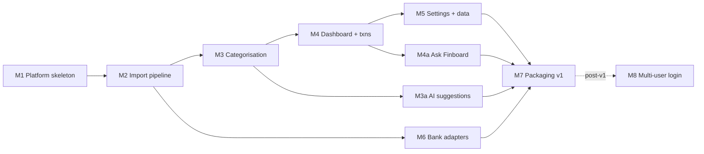

# Finboard — Roadmap

Refines HANDOVER §9. Revision 2 (2026-10-18): async, Postgres, Celery/Redis, ready for multiple users ([ADR-0021](adr/0021-multi-user-ready-single-user-first.md)…[0029](adr/0029-observability.md)). Every milestone ends with green CI and a short demo, and uses **synthetic data only**.

Revision 3 (2026-11-04): adds **optional AI features** ([ADR-0030](adr/0030-assistive-ai-opt-in.md)…[0032](adr/0032-nl-analytics-langgraph.md)): local category suggestions (**M3a**) and natural-language questions answered as charts (**M4a**). Finboard is also the owner's Python + AI portfolio project, so these milestones are about learning LangChain, LangGraph, embeddings, pgvector and LLM evaluation, without weakening the privacy promise.

Changes vs §9:
- **M1 is bigger.** It lays the platform that everything else relies on: async DB, tenancy + RLS, jobs, auth seam, observability.
- **M4 includes the budgets backend**, because the dashboard needs it.
- **M6 (real bank adapters)** can start in parallel right after M2.
- **M8 (post-v1)** turns on real multi-user login.
- **M3a and M4a (AI, opt-in)** come right after the milestones whose data they need. Both ship in v1 but are off by default.

---

## M0 — Architecture (this phase)
**Acceptance:** owner approves the docs. *(ADR-0015 and ADR-0017 accepted 2026-10-18.)*

## M1 — Platform skeleton ✅ (2026-10-18)
*Done: 81 backend tests (integration, tenancy, unit) + 15 frontend tests; ruff, mypy strict, import-linter, oxlint, tsc clean. `finboard init` (secret key) moves to M2 where the first secret is needed; the user-facing compose file stays in M7.*

**Scope:** monorepo. `deploy/compose.dev.yaml` (Postgres 18, Redis 7). FastAPI `create_app` + lifespan. pydantic-settings config. structlog + request-id middleware. Host/Origin/CSRF-header middleware. Async SQLAlchemy engine, UoW, repository base. Alembic async env with roles, RLS helper, `app_user`, `account`, `category`, `job`, settings tables. `AuthBackend` + `LocalSingleUserBackend` + `finboard init` (creates the `local` user, secret key). User provisioning (seed categories). Accounts + categories CRUD (API + Settings tabs). Celery app + `job` resource + a `maintenance.ping` job working end to end. `/me`, `/health/*`, `/meta`. Vite shell + router + `AuthGate` + theme tokens. OpenAPI → TS types. CI pipeline. Privacy checks. Handover moved to `docs/handover/`.

| Acceptance criterion | Proven by |
|---|---|
| `docker compose -f deploy/compose.dev.yaml up -d` + `uv run finboard dev` gives API reload, worker and Vite. Edits hot-reload | demo; `tests/integration/test_health.py` (`/health/ready` checks DB + Redis) |
| `Host: evil.com` → 421. POST without `X-Finboard-Client` → 403. Foreign `Origin` → 403 | `tests/integration/test_security.py` |
| Tenancy: as user B, every accounts/categories route on user A's ids → 404. RLS hides A's rows from B in raw SQL. Composite FK rejects a cross-user reference | `tests/integration/tenancy/test_isolation.py`, `test_rls.py` |
| Every table with `user_id` has RLS enabled + forced + a policy | `tests/integration/tenancy/test_rls_coverage.py` (catalog introspection) |
| Migrations up/down/up clean, and `alembic check` reports no drift | `tests/integration/test_migrations.py` |
| A job enqueued via API is picked up by the worker, and its status moves queued → running → succeeded | `tests/integration/test_jobs.py` |
| Logs are JSON with `request_id`, and sensitive keys are redacted | `tests/unit/test_logging.py` |
| Layer rules enforced. Repo contains no PDFs, dumps or zips | import-linter, privacy job in CI |

## M2 — Import pipeline ✅ (2026-11-04)
*Done: 233 backend tests (unit, parser contract, integration, tenancy; incl. the hung-parser hard kill on Linux) + 24 frontend tests + the first Playwright e2e test; ruff, mypy strict, import-linter, oxlint, tsc clean. CI runs the contract suite on Linux, macOS and Windows, and has an e2e job. Deviations:*
- *`icici_savings_pdf` is not in M2. It needs the owner's statement layout and moves to issue #9, together with the row "owner imports 3 real ICICI statements". M2 ships `generic_table` (fallback) and a working contributor `_template` adapter.*
- *Fallback parsers rank below bank-specific ones, and fixture builders are discovered through the `finboard.parser_fixtures` entry points ([ADR-0033](adr/0033-fallback-parsers-and-fixture-discovery.md)).*
- *Per-user parse cap (default 2): extra uploads wait as `uploaded`. Hard kills are recorded by `Request.on_timeout` ([ADR-0034](adr/0034-parse-cap-and-hard-kill.md)).*
- *Vitest uses the existing `mockApi()` fetch stub, not MSW. The e2e test runs against `finboard serve` + a worker on `finboard_test` (`e2e/stack.py`), not the M7 compose stack.*
- *Reconciliation uses the account's type (credit_card/loan = liability) once the account is known, otherwise the parser's `balance_kind`. A running-balance break is a mismatch even when the totals agree.*
- *Until M3, committed rows go to Uncategorized / Uncategorized income with `needs_review`, and `description_norm` is the dedupe form.*
- *Account delete → 409 when it has transactions; category delete → 409 when in use.*

**Scope:** parser SDK v1 (adapter contract), entry-point registry, **`icici_savings_pdf` as the first real adapter** (dogfooding from day one), `generic_table` fallback adapter, `finboard inspect-layout <pdf>` (prints a statement's *structure* locally with every digit → `9` and letter → `X`, so the layout can be shared to build fixtures without exposing data), reportlab builders + contract suite, BlobStore (local FS), `imports.process` Celery task (decrypt, detect, parse, reconcile asset/liability, match account, fingerprint, dedupe, stage), ephemeral password handoff, preview, row edits, commit (`FOR UPDATE`, `ON CONFLICT`), discard, rollback with overlap reassignment, Idempotency-Key, import history, Import page with job polling, Settings › Parsers (read-only) and › Import history.

| Acceptance criterion | Proven by |
|---|---|
| Every registered adapter passes the contract suite on Linux, macOS and Windows | `tests/parsers/test_contract.py` (OS matrix) |
| ~~Owner imports their last 3 real ICICI savings statements locally: all reconcile, and re-import skips everything~~ | moved to issue #9 (`icici_savings_pdf`) |
| `inspect-layout` output contains no digits or letters from the source values | `tests/unit/test_inspect_layout.py` |
| Encrypted PDF: needs_password → wrong password error → right password → preview | `tests/integration/test_import_flow.py` |
| Password never in Postgres, job params, broker messages, blobs or logs, and the Redis key is gone after use | `test_import_flow.py::test_password_never_persisted` |
| Hung adapter is killed by the hard time limit → import `failed`, worker recovers | `tests/integration/test_parse_timeout.py` (sleeping test adapter, real worker) |
| Same statement twice → 0 inserted, N skipped. Two concurrent commits of overlapping imports → no duplicates | `test_import_flow.py::test_idempotent`, `::test_concurrent_commit` |
| Rollback of A keeps rows shared with later B | `test_import_flow.py::test_rollback_overlap` |
| Reconciliation mismatch blocks commit. Override recorded. Credit-card (liability) statement reconciles | `tests/unit/test_reconcile.py`, flow tests |
| Retried `POST /imports` with the same Idempotency-Key creates one import | `tests/integration/test_idempotency.py` |
| User B cannot see, commit or roll back user A's import | `tests/integration/tenancy/test_imports_isolation.py` |
| UI: drop → password → progress → preview → commit | Vitest `ImportPage.test.tsx` (`mockApi`); Playwright `e2e/tests/import.spec.ts` |

## M3 — Categorisation ✅ (2026-11-04)
*Done: 371 backend tests (incl. the 50k × 200 re-apply perf test, about 5 s against the 10 s budget) + 36 frontend tests; ruff, mypy strict, import-linter (new contract: `categorisation` is pure), oxlint, tsc clean. Review page, CategoriseDialog and Settings › Rules checked in light, dark and at 400 px. Deviations ([ADR-0035](adr/0035-categorisation-as-built.md)):*
- *The rule suggester proposes the first merchant token, not the longest (narrations put the merchant before the city).*
- *`transfer_pair` uses partial unique indexes, so rejected pairs can be remembered. Undoing a pair keeps it as rejected; recategorising one side by hand undoes the pair.*
- *Existing users add the starter pack with `POST /rules/starter-pack` (new users get it at provisioning). Loan/insurance/mutual-fund rows default to Account movement.*
- *The perf test lives in `tests/integration/perf/test_reapply.py` (it needs the integration fixtures).*

**Scope:** normaliser, matcher (+ regex timeout), categorise in the parse task, rules CRUD/reorder/test/enable, `rules.apply` job (dry run + apply), review groups, CategoriseDialog + rule suggestion, `transfers.suggest` job + confirm/reject, rule pack export/import, starter pack, Settings › Rules.

| Acceptance criterion | Proven by |
|---|---|
| Normaliser golden cases (UPI, NEFT, IMPS, POS, ECS, card masks). Hypothesis: idempotent | `tests/unit/test_normalise.py`; starter pack: `tests/unit/test_starter_rules.py` |
| First match by priority, id. Constraints AND-ed. Regex timeout disables the rule | `tests/unit/test_matcher.py` |
| Re-apply respects provenance (manual only with flag; transfer never) | `tests/integration/test_rules_apply.py` |
| Suggestion for `UPI/DR/412345678901/SWIGGY LTD/…` → `contains SWIGGY`, and the match count is right | `tests/unit/test_suggest.py`, `tests/integration/test_review.py` |
| Transfer pairing ±3 days, 1:1, rejected pairs not re-suggested, CC payment → Card payment | `tests/unit/test_pairing.py`, `tests/integration/test_transfers.py` |
| Rule packs leak no account ids and round-trip | `tests/integration/test_rule_packs.py`; tenancy: `tests/integration/tenancy/test_categorisation_isolation.py` |
| 50k txns × 200 rules re-applied in < 10 s in a worker | `tests/integration/perf/test_reapply.py` (`perf`) |

## M3a — AI category suggestions (local, after M3)
*AI is optional and off by default ([ADR-0030](adr/0030-assistive-ai-opt-in.md)). Can run in parallel with M4.*

**Scope:** `ai` optional extra (`fastembed`, ONNX runtime, no PyTorch, so it stays light on a 16 GB laptop). DB image → `pgvector/pgvector:pg18` in `compose.dev.yaml` and the CI service. Migration: `vector` extension + `txn_embedding` with RLS ([ADR-0031](adr/0031-pgvector-embeddings.md)). `finboard ai fetch-model` (the only download; then offline). `ai.embed` (after each commit) and `ai.embed_all` (backfill, re-embed on model change) on a new `ai` queue, concurrency 1. Suggestion service: k-nearest neighbours (k = 10, cosine) over the user's rule/manual-categorised txns → weighted vote → top 3 with confidence and the nearest examples as the "why". `GET /transactions/{id}/suggestions`. CategoriseDialog and review groups show suggestions, with **Accept** (manual) and **Make a rule** (feeds the M3 rule suggester). Settings › AI per-user opt-in (the operator's `FINBOARD_AI_SUGGESTIONS` only makes it available). `finboard worker` consumes the `ai` queue when suggestions are available. Suggestion eval on generated description variants with a character n-gram / `rapidfuzz` baseline.

| Acceptance criterion | Proven by |
|---|---|
| Without the `ai` extra, the app starts and every M1–M3 test passes | CI job without the extra |
| A suggestion is never applied automatically. Accepting one sets `categorised_by=manual` | `tests/integration/test_ai_suggestions.py` |
| On generated description variants (typos, UPI handles, truncation; exact repeats excluded), embeddings beat the n-gram / `rapidfuzz` baseline on top-1 accuracy. Both numbers recorded in the PR; if they don't, M3a ships the baseline instead | `tests/ai/test_suggest_eval.py` |
| Suggestions appear only for users who opted in, on a server where the feature is available | `tests/integration/test_ai_suggestions.py` |
| User B never gets user A's neighbours (RLS on `txn_embedding`) | `tests/integration/tenancy/test_ai_isolation.py` |
| After `fetch-model`, embedding runs with the network blocked | `pytest-socket` in `tests/ai/` |
| Owner's laptop: 5k txns embedded in < 60 s, worker RSS < 600 MB | `perf` marker (manual run, results in PR) |

## M4 — Dashboard + transactions ✅ (2026-11-04; owner visual sign-off pending)
*Done: 412 backend tests (golden Sep 2026, metric edge cases, ETag/304, `/transactions` paging for every sort, tenancy, perf) + 85 frontend tests + 8 Playwright tests (dashboard interactions, axe in light and dark, 400 px, import). `/dashboard` p95 87 ms and a `/transactions` page 20 ms for a 50k-txn user in a 100-user DB. Locust, 200 users: p95 57 ms with 3 API processes (930 ms with one). Deviations ([ADR-0036](adr/0036-dashboard-as-built.md)):*
- *Limits summary "left" = Σ limit − Σ spent, as in the approved mockup (§12 said Σ max(remaining, 0)).*
- *Percentages are rounded once, to 1 place, on the server (double rounding gave −11.2 % instead of the mockup's −11.3 %).*
- *Golden, perf and ETag tests live under `tests/integration/`; e2e runs against `finboard serve` with the demo data (`e2e/stack.py`).*
- *`finboard serve --workers N` added for the load budget; the default stays 1.*

**Scope:** `domain/metrics.py` + definitions, budgets backend, `/dashboard` (+ ETag via `data_version`), `/transactions` (keyset paging, trigram search), `format.ts`, every mockup section, Transactions page, review banner, inline re-categorise, 400 px layout, light/dark, a11y.

| Acceptance criterion | Proven by |
|---|---|
| Golden: Sep 2026 Income ₹1,42,702.04, Spending ₹96,040.38, Net ₹46,661.66, Rate 32.7 %, Δ net −₹22,330.28, 2 over, review 2 | `tests/integration/golden/test_dashboard_golden.py` |
| Metric edge cases (zero income, no prev month, refunds per ADR-0017) | `tests/unit/test_metrics.py` |
| `/dashboard` p95 < 200 ms for a 50k-txn user in a 100-user DB. Unchanged data → 304 | `tests/integration/perf/test_dashboard_perf.py`, `tests/integration/test_etag.py` |
| Load: 200 virtual users, p95 < 300 ms | `backend/tests/load/locustfile.py` (manual run: p95 57 ms with 3 API processes) |
| `₹50K / ₹1L / ₹1.5L / ₹2Cr`. `₹94 over` with no minus | Vitest `format.dashboard.test.ts`, `LimitBar.test.tsx` |
| Filters persist across months and reloads (URL). Category click filters. Banner → review | Vitest `DashboardPage.test.tsx` + Playwright `e2e/tests/dashboard.spec.ts` |
| `aria-sort`, text not colour-only, axe clean in light and dark, no horizontal scroll at 400 px | Playwright `dashboard.spec.ts`; Vitest `DeltaBadge.test.tsx` |
| Owner signs off visual parity with `docs/handover/design/dashboard-mockup.png` | screenshot review (**pending**: light, dark and 400 px screenshots in the PR) |

## M4a — Ask Finboard (after M4)
*Natural-language questions → chart, with pinning to the dashboard ([ADR-0032](adr/0032-nl-analytics-langgraph.md)). Off by default. The LLM never sees transaction data ([ADR-0030](adr/0030-assistive-ai-opt-in.md)).*

**Scope:** `ai_txn` / `ai_budget` views (ordinary views, RLS applies; migration). Per-request **SQLite sandbox** (`ai/sandbox.py`) for model-written SQL, loaded with the caller's rows only ([ADR-0032](adr/0032-nl-analytics-langgraph.md)). `finboard/ai/catalog.yaml` (versioned sandbox table and column descriptions for prompts). `QuerySpec` (Pydantic) + deterministic SQL builder on the §12 metric definitions. LangGraph graph: understand → build or generate SQL → guard (`sqlglot`, function allow-list, transpile to SQLite) → execute (spec: Postgres, read-only, RLS, 3 s; SQL: sandbox with authorizer, 3 s, 1,000 rows) → retry ≤ 2 with locally generated error text → choose chart → templated answer, or a clarifying question. `finboard.ai.llm` (the single outbound module): LangChain chat model, **Gemini Flash** by default (`langchain-google-genai`), Ollama optional, 429 handling, account aliases instead of names, tracing forced off, rows kept out of graph state (local result store). SQL path behind `FINBOARD_AI_ASK_SQL` (off until the sandbox tests pass). Endpoints: `POST /ask` · `GET /ask/history` · `DELETE /ask/history/{id}` · `POST /ask/{id}/pin` · `GET /dashboard/widgets` · `DELETE /dashboard/widgets/{id}`. UI: an Ask panel on the dashboard (question box with a note that the question is sent to <provider> and, on Gemini's free tier, may be used to improve Google's products, chart or table, "show query", Pin). Pinned widgets render below the mockup sections. Eval harness: `finboard ai eval` with ~30 golden questions → `docs/ai-eval.md`. README: demo GIF + eval table.

| Acceptance criterion | Proven by |
|---|---|
| "Give a monthly breakdown of eating out and provisions in the last six months" → grouped bars, month × category, totals equal to the dashboard's | `tests/golden/test_ask_golden.py` (recorded LLM response) |
| No LLM request contains any description, amount, balance or account number from the fixtures (canary values) | `tests/ai/test_privacy_boundary.py` |
| Guard rejects DML/DDL, multiple statements, base tables (e.g. `txn`), deny-listed functions and comments hiding statements | `tests/unit/test_sql_guard.py` (+ Hypothesis) |
| Even with the guard bypassed, model SQL in the sandbox sees only the caller's rows, and the authorizer blocks non-allow-listed functions, `ATTACH`, `PRAGMA` and writes | `tests/unit/test_sandbox.py`, `tests/integration/tenancy/test_ask_isolation.py` |
| Retry messages contain no data values (canary in a failing cast); tracing stays off with LangSmith env vars set; no graph state snapshot contains result rows | `tests/ai/test_privacy_boundary.py` |
| Pinned SQL is re-guarded on refresh; a catalog-version change shows "needs updating" instead of numbers | `test_ask.py::test_pinned_widget_catalog_change` |
| A slow query is cut off at 3 s. Provider 429 or timeout → problem+json `ai_unavailable`, no 500 | `tests/integration/test_ask.py` (fake LLM) |
| Refreshing a pinned widget makes no LLM call | `test_ask.py::test_pinned_widget_offline` |
| `FINBOARD_AI_ASK=off`, or the user hasn't opted in → `/ask` returns 404 and the panel is hidden | `test_ask.py`, Vitest |
| Live eval: spec-path execution accuracy ≥ 80 %, SQL path reported separately | `finboard ai eval` (manual; results committed to `docs/ai-eval.md`) |

## M5 — Settings polish & data
**Scope:** Budgets tab (effective-from), category merge, parser enable/options per user, Preferences, `data.export`/`data.import` jobs (per-user logical export: JSON + archived PDFs zip), CSV export, `data.delete_user_data`, staged-import expiry (beat), pre-migration `pg_dump`.

| Acceptance criterion | Proven by |
|---|---|
| Budget change from month M leaves earlier months unchanged | `tests/unit/test_budget_lookup.py` |
| Category merge moves txns, rules and budgets | `tests/integration/test_categories.py::test_merge` |
| Export → delete-all → import gives an identical dataset (counts + checksums) | `tests/integration/test_export_import.py` |
| Malicious import zip (traversal, extra members, newer version) rejected | `test_export_import.py::test_rejects_*` |
| Delete-all removes only the caller's rows and blobs | `tests/integration/tenancy/test_delete_all.py` |

## M6 — Remaining bank adapters (parallel after M2)
**Scope, in order:** `icici_savings_pdf` (issue #9, moved from M2) → `icici_cc_pdf` (second, because it exercises the liability/reconciliation path early) → `kotak_savings_pdf` → `hsbc_savings_pdf` → `yes_savings_pdf` → `csb_savings_pdf` (order confirmed by owner). Optional later: `hdfc_home_loan_pdf`, LIC premium statement, MF CAS (v2). These are not needed for correct metrics; see ARCHITECTURE §9. Each has a layout-only synthetic fixture builder. The owner validates locally on real statements, which never enter the repo. `CONTRIBUTING.md › How to add your bank` and the `_template` adapter landed early, in M2.

| Acceptance criterion | Proven by |
|---|---|
| Each adapter passes the contract suite. No cross-detection ≥ 0.5 | `tests/parsers/test_contract.py` |
| Owner: last 3 real statements per account reconcile. ≥ 80 % auto-categorised with starter pack + own rules | owner checklist in PR (no data attached) |
| A newcomer can add an adapter from CONTRIBUTING alone | dry run |

## M7 — Packaging v1
**Scope:** multi-stage Dockerfile (SPA build → slim Python, non-root), `deploy/compose.yaml` (api, worker, beat, db, redis; only api published on 127.0.0.1), `finboard init`, migrations on start under an advisory lock, release workflow (GHCR image on tag), README with demo-data screenshots, CHANGELOG.

| Acceptance criterion | Proven by |
|---|---|
| Fresh machine: `init` + `compose up` gives a working app at 127.0.0.1:8765. Data survives `down`/`up` | CI compose smoke job |
| Postgres and Redis are not reachable from the host network | CI smoke: port probe fails |
| Image runs as non-root and contains no PDFs, dumps or external URLs in the bundle | CI image checks |
| Playwright happy path passes against the packaged stack | `e2e/happy-path.spec.ts` |

## M8 — Multi-user login (post-v1, outline)
**Scope:** `SessionBackend` (argon2id, Redis sessions, HttpOnly cookies, CSRF token), sign-up/login/logout UI in `AuthGate`, `FINBOARD_MODE=server`, per-user quotas and rate limits, `S3BlobStore`, hosting guide (TLS proxy). **Acceptance:** the tenancy suite passes unchanged with real sessions. Load test with 300 users.
