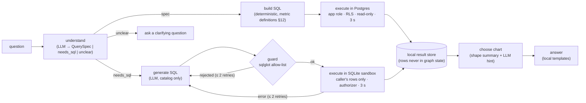

# ADR-0032: "Ask Finboard": spec-first natural-language analytics with LangGraph

**Status:** Accepted (owner decision 2026-11-04; revised after review: model-written SQL now runs in a per-request SQLite sandbox instead of Postgres).

**Context.** The owner wants to ask questions such as *"Give me a monthly breakdown of eating out and provisions for the last six months"* and get a chart on the dashboard. That means understanding the question, building a query, running it and choosing a visual. Raw text-to-SQL is flexible but can be wrong in subtle ways (refund signs per [ADR-0017](0017-signed-metric-sums-refunds.md), transfers counted as spending) and must be made safe.

**Why model SQL can't run in Postgres.** The first draft ran model-written SQL in Postgres as a read-only role under RLS, and claimed those database layers would hold even if the SQL validator were bypassed. They don't: every one of them is a setting a plain `SELECT` can change with `set_config()`.
- `set_config('app.user_id', …)` switches which user's rows RLS shows.
- `set_config('role', 'finboard_app', …)` leaves the restricted role.
- `set_config('statement_timeout', '0', …)` removes the timeout.

That would leave a deny-list in the validator as the only barrier. The fix is to run model SQL where other users' data **does not exist**.

**Decision.** A **LangGraph** state graph with two query paths.

1. **Spec path (default).** The LLM fills a Pydantic `QuerySpec` through structured output: metric (spending, income, net, count), category paths, account aliases, merchant text, date range, grouping (month, category, account, merchant) and a chart hint. A deterministic builder turns the spec into SQL using the **same metric definitions as the dashboard**, and it runs in Postgres as the normal app role, under RLS, in a `READ ONLY` transaction with `statement_timeout = 3s`. The model never writes this SQL, so the `set_config` problem doesn't arise. This path is right by construction.
2. **SQL path (fallback)** for questions a spec can't express. The LLM writes one `SELECT` in the Postgres dialect against two tables described in the catalog, `ai_txn` and `ai_budget`. It then runs in a sandbox:
   - **Guard (`sqlglot`):**
     - exactly one `SELECT`;
     - table references only `ai_txn` and `ai_budget`;
     - **functions from an allow-list only** (aggregates, `date_trunc`, `extract`, `coalesce`, `round`, `abs`, `lower`, `upper`, `like` and `ilike`, `case`, casts…);
     - no `PRAGMA`, `ATTACH`, comments that hide statements, or `WITH RECURSIVE`.

     The query is then transpiled to SQLite.
   - **Sandbox:** a fresh in-memory SQLite database per request (stdlib `sqlite3`), loaded with **only the caller's rows**. The app reads the `ai_txn` and `ai_budget` Postgres views as the caller, under RLS. Up to ~50k rows load in milliseconds. Enforcement at the engine level:
     - `set_authorizer` allows only read operations and the allow-listed functions, and denies `ATTACH`, `PRAGMA` and writes;
     - `PRAGMA query_only = ON`;
     - extension loading stays disabled;
     - a progress handler aborts after 3 s;
     - at most 1,000 rows are fetched.

     The sandbox is discarded after the request. Even if the guard is bypassed, the query can only see the caller's own rows, and there is no `set_config`, role or network.
   - **Money in the sandbox** is stored as integer paise (`signed_paise`), which keeps sums exact. Results are converted to `Decimal` locally.
   - **On error**, a locally generated description goes back to the model, with at most 2 retries ([ADR-0030](0030-assistive-ai-opt-in.md) §3).
3. **Results stay local.** The execute nodes write rows to a per-request result store. The graph state carries only a result id and a shape summary (column names and types, row count). The chart type comes from the shape, with the LLM's hint as a tie-breaker. The answer sentence is filled locally from the result.
4. **Pin to dashboard.** A pinned question stores its spec, or its validated SQL plus the **catalog version** it was written against. Every refresh re-runs locally with **no LLM call**. Pinned SQL goes through the guard again on every refresh. If the catalog version has changed, the widget shows "This chart needs updating" with a one-click re-ask instead of possibly wrong numbers.
5. **Evaluation as a feature.** About 30 golden questions over the synthetic dataset (`docs/handover/design/sample-transactions.csv`), each with its expected result. `finboard ai eval` reports execution accuracy, the path taken, retries, latency and tokens per model, and writes the results to `docs/ai-eval.md`. CI uses recorded LLM responses.

**Options considered for running model-written SQL** (security review, 2026-11-04). The threat model: the model, or a question crafted to steer it (prompt injection), produces SQL whose goal is to read another user's rows, escape the restricted role, run indefinitely, or reach the filesystem or network. Each option was judged by one question: *if the SQL validator is bypassed, what stops that query?*

| # | Option | What breaks it | Verdict |
|---|---|---|---|
| A | Postgres, `SET LOCAL ROLE finboard_ai_ro`, RLS on `app.user_id`, read-only transaction, `statement_timeout`, function **deny-list** (first draft) | Every limit is a session setting a `SELECT` can change. `set_config('app.user_id', …)` gives a cross-user read, `set_config('role', 'finboard_app', …)` leaves the restricted role (the session is allowed to switch back), `set_config('statement_timeout', '0', …)` removes the timeout. The deny-list is then the only barrier, and deny-lists are easy to miss: schema-qualified names, odd casing, functions nobody listed (`pg_advisory_lock`, `query_to_xml`…) | **Rejected**: its defence-in-depth claim is false |
| B | A, plus a separate login role for AI queries (no role to switch back to) | Removes the role escape, but RLS still keys on `app.user_id`, which any session can set. Cross-user reads remain | Rejected |
| C | A, plus `REVOKE EXECUTE ON set_config FROM PUBLIC` | Changes a core built-in that the app itself relies on; easy to undo by a future migration; still leaves the general problem of executing untrusted SQL next to every user's data | Rejected: brittle |
| D | Postgres temp table holding only the caller's rows, `finboard_ai_ro` granted SELECT on that alone | Better, but the AI role still runs in a session that can reach real tables through role switching (A) unless combined with B, and the RLS identity is still forgeable for anything else it can see. Complex to get right | Rejected |
| E | Security-definer function `ai_txn(token)` mapping a random per-request token to a user | Works in theory, but adds secret handling inside SQL text and a custom security mechanism we'd have to prove correct | Rejected: too clever |
| F | **No SQL path: spec-only** | Nothing to break; the model never writes SQL | Safe. Kept as the default path, and as the fallback position if G is ever in doubt |
| G | **Per-request in-memory SQLite sandbox loaded with only the caller's rows** | The data the query can reach is limited to one user *by construction*: other users' rows are not in the process. SQLite has no `set_config`, roles or network functions; extension loading is off; `set_authorizer` enforces the function allow-list and blocks `ATTACH`/`PRAGMA`/writes inside the engine; a progress handler enforces the timeout | **Chosen** for the SQL path |
| H | DuckDB in-memory sandbox | Same isolation idea as G with a closer-to-Postgres dialect, but DuckDB can read files and URLs (`read_csv`, `httpfs`), so those must be locked off. It's also another dependency | Rejected for now: G needs only the standard library |

**Why.** Spec-first gives the same numbers as the dashboard and runs no model-written SQL at all. The SQL path still demonstrates text-to-SQL, but inside a sandbox whose data is limited to one user by construction, so its safety doesn't depend on a validator being perfect. The evaluation compares the two paths.

**Consequences.**
- We maintain two Postgres views, `ai_txn` and `ai_budget`. They are ordinary views (not `security_invoker`): RLS still applies through them because the policies are `FORCE`d even for the owner. They are used by the spec builder and the sandbox loader, and the model never queries them directly.
- We maintain a small catalog (`finboard/ai/catalog.yaml`) that describes the sandbox tables for prompts. Its version is stored on pinned SQL, and changes to it need an eval run.
- The SQL path supports the Postgres features that `sqlglot` can transpile to SQLite; anything else is rejected and the question falls back to a clarifying reply.
- The free-tier rate limits make the eval slow, so it runs manually and not in CI.
